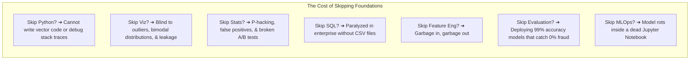

# 🌐 The Complete Data Science & Artificial Intelligence Master Curriculum
### *An End-to-End Hierarchical Progression Architecture: From Absolute Scratch to Production MLOps*

---

## 🧭 Executive Overview & Repository Philosophy

Welcome to the **Data Science & AI Master Workspace**. This repository is not a random collection of tutorials or disconnected Jupyter notebooks; it is a **rigorously engineered, hierarchical progression system** designed to take an engineer from zero coding experience to building, validating, deploying, and monitoring production-grade machine learning and statistical decision systems.

The core design philosophy of this curriculum is **Sequential Dependency**:
> **In Data Science, each layer of abstraction is strictly bounded by the integrity of the layer beneath it.**  
> If you build Machine Learning models without Feature Engineering, your models learn garbage.  
> If you engineer features without Exploratory Visualization and Statistics, you induce silent data leakage.  
> If you analyze data without SQL, you cannot extract data from enterprise data warehouses.  
> And if you do any of this without deep Python proficiency, your code will fail under production load.

```mermaid
flowchart TD
    classDef foundation fill:#1e293b,stroke:#3b82f6,stroke-width:2px,color:#f8fafc;
    classDef analytics fill:#1e293b,stroke:#06b6d4,stroke-width:2px,color:#f8fafc;
    classDef stats fill:#1e293b,stroke:#8b5cf6,stroke-width:2px,color:#f8fafc;
    classDef data fill:#1e293b,stroke:#f59e0b,stroke-width:2px,color:#f8fafc;
    classDef fe fill:#1e293b,stroke:#ec4899,stroke-width:2px,color:#f8fafc;
    classDef ml fill:#1e293b,stroke:#10b981,stroke-width:2px,color:#f8fafc;
    classDef eval fill:#1e293b,stroke:#f43f5e,stroke-width:2px,color:#f8fafc;
    classDef ops fill:#1e293b,stroke:#6366f1,stroke-width:2px,color:#f8fafc;

    S0["STEP 0: Computational Foundations<br>📁 00 - Python (Days 000–025)"]:::foundation
    S1["STEP 1: Visual Analytics & Storytelling<br>📁 01 - Data Visualization (Days 01–14)"]:::analytics
    S2["STEP 2: Applied Statistics & Experimentation<br>📁 02 - Applied Statistics (Days 01–14)"]:::stats
    S3["STEP 3: Enterprise Data Extraction<br>📁 03 - SQL & Databases"]:::data
    S4["STEP 4: Mathematical Representation<br>📁 04 - Feature Engineering"]:::fe
    S5["STEP 5: Predictive Modeling & Ensembles<br>📁 05 - Machine Learning"]:::ml
    S6["STEP 6: Diagnostic Rigor & Optimization<br>📁 06 - Model Evaluation"]:::eval
    S7["STEP 7: Serving & Production Engineering<br>📁 07 - Deep Learning & MLOps"]:::ops

    S0 -->|"Arrays & DataFrames"| S1
    S1 -->|"Exploratory Intuition"| S2
    S2 -->|"Hypothesis Testing & Metrics"| S3
    S3 -->|"Relational Data Ingestion"| S4
    S4 -->|"Leakage-Free Feature Tensors"| S5
    S5 -->|"Candidate Estimators"| S6
    S6 -->|"Calibrated Best Model"| S7

    click S0 "file:///c:/Users/Pankaj%20Kumar/OneDrive/Desktop/Data%20Science/00%20-%20Python" "Open 00 - Python Folder"
    click S1 "file:///c:/Users/Pankaj%20Kumar/OneDrive/Desktop/Data%20Science/01%20-%20Data%20Visualization" "Open 01 - Data Visualization Folder"
    click S2 "file:///c:/Users/Pankaj%20Kumar/OneDrive/Desktop/Data%20Science/02%20-%20Applied%20Statistics" "Open 02 - Applied Statistics Folder"
    click S3 "file:///c:/Users/Pankaj%20Kumar/OneDrive/Desktop/Data%20Science/03%20-%20SQL%20%26%20Databases" "Open 03 - SQL & Databases Folder"
    click S4 "file:///c:/Users/Pankaj%20Kumar/OneDrive/Desktop/Data%20Science/04%20-%20Feature%20Engineering" "Open 04 - Feature Engineering Folder"
    click S5 "file:///c:/Users/Pankaj%20Kumar/OneDrive/Desktop/Data%20Science/05%20-%20Machine%20Learning" "Open 05 - Machine Learning Folder"
    click S6 "file:///c:/Users/Pankaj%20Kumar/OneDrive/Desktop/Data%20Science/06%20-%20Model%20Evaluation" "Open 06 - Model Evaluation Folder"
    click S7 "file:///c:/Users/Pankaj%20Kumar/OneDrive/Desktop/Data%20Science/07%20-%20Deep%20Learning%20%26%20MLOps" "Open 07 - Deep Learning & MLOps Folder"
```



---

## 🧭 Interactive Master Pillar Navigator (Click to Open Folder Directly)

Click on any pillar's **Folder Link** to immediately open the directory in File Explorer / Editor:

| Step | Hierarchical Stage | Open Folder Directly | Comprehensive Guide | Scale & Duration | Status |
| :---: | :--- | :--- | :--- | :--- | :---: |
| **0** | **Computational Foundations** | [📂 `00 - Python/`](file:///c:/Users/Pankaj%20Kumar/OneDrive/Desktop/Data%20Science/00%20-%20Python) | [📖 `00 - Python/README.md`](file:///c:/Users/Pankaj%20Kumar/OneDrive/Desktop/Data%20Science/00%20-%20Python/README.md) | 25 Days (Days 000–025), 118+ Scripts | ✅ Completed |
| **1** | **Visual Analytics & Storytelling** | [📊 `01 - Data Visualization/`](file:///c:/Users/Pankaj%20Kumar/OneDrive/Desktop/Data%20Science/01%20-%20Data%20Visualization) | [📖 `01 - Data Visualization/README.md`](file:///c:/Users/Pankaj%20Kumar/OneDrive/Desktop/Data%20Science/01%20-%20Data%20Visualization/README.md) | 14 Days (Days 01–14), 42 Scripts + BI App | ✅ Completed |
| **2** | **Applied Statistics & Experimentation** | [📐 `02 - Applied Statistics/`](file:///c:/Users/Pankaj%20Kumar/OneDrive/Desktop/Data%20Science/02%20-%20Applied%20Statistics) | [📖 `02 - Applied Statistics/README.md`](file:///c:/Users/Pankaj%20Kumar/OneDrive/Desktop/Data%20Science/02%20-%20Applied%20Statistics/README.md) | 14 Days (Days 01–14), 42 Scripts + Capstone | ✅ Completed |
| **3** | **Enterprise Data Extraction (SQL)** | [🗄️ `03 - SQL & Databases/`](file:///c:/Users/Pankaj%20Kumar/OneDrive/Desktop/Data%20Science/03%20-%20SQL%20%26%20Databases) | [📖 `03 - SQL & Databases/README.md`](file:///c:/Users/Pankaj%20Kumar/OneDrive/Desktop/Data%20Science/03%20-%20SQL%20%26%20Databases/README.md) | Window Functions, CTEs, Python Pipeline | ✅ Production Ready |
| **4** | **Mathematical Feature Engineering** | [🛠️ `04 - Feature Engineering/`](file:///c:/Users/Pankaj%20Kumar/OneDrive/Desktop/Data%20Science/04%20-%20Feature%20Engineering) | [📖 `04 - Feature Engineering/README.md`](file:///c:/Users/Pankaj%20Kumar/OneDrive/Desktop/Data%20Science/04%20-%20Feature%20Engineering/README.md) | ColumnTransformer, Scaling, Zero Leakage | ✅ Production Ready |
| **5** | **Predictive Modeling & Ensembles** | [🤖 `05 - Machine Learning/`](file:///c:/Users/Pankaj%20Kumar/OneDrive/Desktop/Data%20Science/05%20-%20Machine%20Learning) | [📖 `05 - Machine Learning/README.md`](file:///c:/Users/Pankaj%20Kumar/OneDrive/Desktop/Data%20Science/05%20-%20Machine%20Learning/README.md) | Multi-Model CV Benchmark, Tree Ensembles | ✅ Production Ready |
| **6** | **Diagnostic Rigor & Metric Tuning** | [🎯 `06 - Model Evaluation/`](file:///c:/Users/Pankaj%20Kumar/OneDrive/Desktop/Data%20Science/06%20-%20Model%20Evaluation) | [📖 `06 - Model Evaluation/README.md`](file:///c:/Users/Pankaj%20Kumar/OneDrive/Desktop/Data%20Science/06%20-%20Model%20Evaluation/README.md) | ROC-AUC, Precision-Recall, Cost Matrix | ✅ Production Ready |
| **7** | **Deep Learning & Production MLOps** | [🚀 `07 - Deep Learning & MLOps/`](file:///c:/Users/Pankaj%20Kumar/OneDrive/Desktop/Data%20Science/07%20-%20Deep%20Learning%20%26%20MLOps) | [📖 `07 - Deep Learning & MLOps/README.md`](file:///c:/Users/Pankaj%20Kumar/OneDrive/Desktop/Data%20Science/07%20-%20Deep%20Learning%20%26%20MLOps/README.md) | Joblib Model Artifact, FastAPI Service | ✅ Production Ready |

---

## 🔍 Why You Cannot Skip Ahead



---

### 🟢 STEP 0: Computational Foundations (`00 - Python/`)
* **📂 Direct Folder Access**: [`c:/Users/Pankaj Kumar/OneDrive/Desktop/Data Science/00 - Python`](file:///c:/Users/Pankaj%20Kumar/OneDrive/Desktop/Data%20Science/00%20-%20Python)
* **📖 Detailed Master Guide**: [`00 - Python/README.md`](file:///c:/Users/Pankaj%20Kumar/OneDrive/Desktop/Data%20Science/00%20-%20Python/README.md)
* **Scope**: 25 Days (Days 000–025), 118+ production scripts, 5 progressive phases.

#### 💡 Why You Must Learn It:
Python is the foundational language of Modern AI and Data Science. Everything from deep neural networks in PyTorch to data manipulation in Pandas is built on Python. You cannot optimize an algorithm, engineer features, or debug a distributed memory leak if you do not understand mutable vs immutable types, list comprehensions, generator memory efficiency, object-oriented design, and vector broadcasting.

#### ⚠️ The Fatal Flaw of Skipping Step 0:
Engineers who skip pure Python write slow, unmaintainable code full of inefficient nested loops, encounter frequent `KeyError` and `IndexError` exceptions, fail to structure modular packages, and are paralyzed when moving beyond basic notebook cells.

#### 📂 Complete 26-Day Folder Navigator (`00 - Python` — Click Any Day to Open Folder):
| Day Folder (Opens Directly) | Focus Area & Mathematical Concepts | Key Files Inside Folder |
| :--- | :--- | :--- |
| [📂 **Day 000**](file:///c:/Users/Pankaj%20Kumar/OneDrive/Desktop/Data%20Science/00%20-%20Python/Day%20000) | **Orientation & Python Ecosystem**<br>*Zen of Python, C-under-the-hood, comparative analysis, pure Python data science pipeline simulation.* | • [📖 `README.md`](file:///c:/Users/Pankaj%20Kumar/OneDrive/Desktop/Data%20Science/00%20-%20Python/Day%20000/README.md)<br>• [`01_why_learn_python.py`](file:///c:/Users/Pankaj%20Kumar/OneDrive/Desktop/Data%20Science/00%20-%20Python/Day%20000/01_why_learn_python.py)<br>• [`02_python_data_science_simulation.py`](file:///c:/Users/Pankaj%20Kumar/OneDrive/Desktop/Data%20Science/00%20-%20Python/Day%20000/02_python_data_science_simulation.py) |
| [📂 **Day 001**](file:///c:/Users/Pankaj%20Kumar/OneDrive/Desktop/Data%20Science/00%20-%20Python/Day%20001) | **Python Setup, Syntax & First Program**<br>*VS Code setup, venv, indentation rules, comments, docstrings, print formatting, sep/end.* | • [📖 `README.md`](file:///c:/Users/Pankaj%20Kumar/OneDrive/Desktop/Data%20Science/00%20-%20Python/Day%20001/README.md)<br>• [`First.py`](file:///c:/Users/Pankaj%20Kumar/OneDrive/Desktop/Data%20Science/00%20-%20Python/Day%20001/First.py)<br>• [`01_syntax_and_comments.py`](file:///c:/Users/Pankaj%20Kumar/OneDrive/Desktop/Data%20Science/00%20-%20Python/Day%20001/01_syntax_and_comments.py)<br>• [`02_print_and_formatting.py`](file:///c:/Users/Pankaj%20Kumar/OneDrive/Desktop/Data%20Science/00%20-%20Python/Day%20001/02_print_and_formatting.py)<br>• [`03_practice_challenge.py`](file:///c:/Users/Pankaj%20Kumar/OneDrive/Desktop/Data%20Science/00%20-%20Python/Day%20001/03_practice_challenge.py) |
| [📂 **Day 002**](file:///c:/Users/Pankaj%20Kumar/OneDrive/Desktop/Data%20Science/00%20-%20Python/Day%20002) | **Variables, Dynamic Typing & Naming**<br>*Primitive data types, dynamic typing, variable reassignment, PEP 8 snake_case, type/id/isinstance.* | • [📖 `README.md`](file:///c:/Users/Pankaj%20Kumar/OneDrive/Desktop/Data%20Science/00%20-%20Python/Day%20002/README.md)<br>• [`Variable.py`](file:///c:/Users/Pankaj%20Kumar/OneDrive/Desktop/Data%20Science/00%20-%20Python/Day%20002/Variable.py)<br>• [`DataType.py`](file:///c:/Users/Pankaj%20Kumar/OneDrive/Desktop/Data%20Science/00%20-%20Python/Day%20002/DataType.py)<br>• [`naming.py`](file:///c:/Users/Pankaj%20Kumar/OneDrive/Desktop/Data%20Science/00%20-%20Python/Day%20002/naming.py)<br>• [`practice_challenge.py`](file:///c:/Users/Pankaj%20Kumar/OneDrive/Desktop/Data%20Science/00%20-%20Python/Day%20002/practice_challenge.py) |
| [📂 **Day 003**](file:///c:/Users/Pankaj%20Kumar/OneDrive/Desktop/Data%20Science/00%20-%20Python/Day%20003) | **Type Casting, Dynamic Input & Operators**<br>*Implicit/explicit casting, input parsing, arithmetic, comparison, logical, identity (is), membership (in).* | • [📖 `README.md`](file:///c:/Users/Pankaj%20Kumar/OneDrive/Desktop/Data%20Science/00%20-%20Python/Day%20003/README.md)<br>• [`01_type_casting.py`](file:///c:/Users/Pankaj%20Kumar/OneDrive/Desktop/Data%20Science/00%20-%20Python/Day%20003/01_type_casting.py)<br>• [`02_user_input.py`](file:///c:/Users/Pankaj%20Kumar/OneDrive/Desktop/Data%20Science/00%20-%20Python/Day%20003/02_user_input.py)<br>• [`03_operators.py`](file:///c:/Users/Pankaj%20Kumar/OneDrive/Desktop/Data%20Science/00%20-%20Python/Day%20003/03_operators.py)<br>• [`04_bmi_calculator.py`](file:///c:/Users/Pankaj%20Kumar/OneDrive/Desktop/Data%20Science/00%20-%20Python/Day%20003/04_bmi_calculator.py) |
| [📂 **Day 004**](file:///c:/Users/Pankaj%20Kumar/OneDrive/Desktop/Data%20Science/00%20-%20Python/Day%20004) | **Conditional Statements & Logic**<br>*if/elif/else branching, nested data quality validation, ternary operator, truthy and falsy rules.* | • [📖 `README.md`](file:///c:/Users/Pankaj%20Kumar/OneDrive/Desktop/Data%20Science/00%20-%20Python/Day%20004/README.md)<br>• [`01_if_elif_else.py`](file:///c:/Users/Pankaj%20Kumar/OneDrive/Desktop/Data%20Science/00%20-%20Python/Day%20004/01_if_elif_else.py)<br>• [`02_nested_conditionals.py`](file:///c:/Users/Pankaj%20Kumar/OneDrive/Desktop/Data%20Science/00%20-%20Python/Day%20004/02_nested_conditionals.py)<br>• [`03_ternary_operator.py`](file:///c:/Users/Pankaj%20Kumar/OneDrive/Desktop/Data%20Science/00%20-%20Python/Day%20004/03_ternary_operator.py)<br>• [`04_truthy_falsy.py`](file:///c:/Users/Pankaj%20Kumar/OneDrive/Desktop/Data%20Science/00%20-%20Python/Day%20004/04_truthy_falsy.py)<br>• [`05_grading_system.py`](file:///c:/Users/Pankaj%20Kumar/OneDrive/Desktop/Data%20Science/00%20-%20Python/Day%20004/05_grading_system.py) |
| [📂 **Day 005**](file:///c:/Users/Pankaj%20Kumar/OneDrive/Desktop/Data%20Science/00%20-%20Python/Day%20005) | **Loops Part 1: For Loops & Iteration**<br>*Sequence iteration, range(start, stop, step), enumerate index tracking, zip parallel pairing, nested grid loops.* | • [📖 `README.md`](file:///c:/Users/Pankaj%20Kumar/OneDrive/Desktop/Data%20Science/00%20-%20Python/Day%20005/README.md)<br>• [`01_for_loop_basics.py`](file:///c:/Users/Pankaj%20Kumar/OneDrive/Desktop/Data%20Science/00%20-%20Python/Day%20005/01_for_loop_basics.py)<br>• [`02_range_function.py`](file:///c:/Users/Pankaj%20Kumar/OneDrive/Desktop/Data%20Science/00%20-%20Python/Day%20005/02_range_function.py)<br>• [`03_enumerate_and_zip.py`](file:///c:/Users/Pankaj%20Kumar/OneDrive/Desktop/Data%20Science/00%20-%20Python/Day%20005/03_enumerate_and_zip.py)<br>• [`04_nested_for_loops.py`](file:///c:/Users/Pankaj%20Kumar/OneDrive/Desktop/Data%20Science/00%20-%20Python/Day%20005/04_nested_for_loops.py)<br>• [`05_loop_practice_math.py`](file:///c:/Users/Pankaj%20Kumar/OneDrive/Desktop/Data%20Science/00%20-%20Python/Day%20005/05_loop_practice_math.py) |
| [📂 **Day 006**](file:///c:/Users/Pankaj%20Kumar/OneDrive/Desktop/Data%20Science/00%20-%20Python/Day%20006) | **Loops Part 2: While Loops & Control**<br>*Convergence loops, break early exit, continue skip, pass placeholder, while-else clause, sentinel protection.* | • [📖 `README.md`](file:///c:/Users/Pankaj%20Kumar/OneDrive/Desktop/Data%20Science/00%20-%20Python/Day%20006/README.md)<br>• [`01_while_basics.py`](file:///c:/Users/Pankaj%20Kumar/OneDrive/Desktop/Data%20Science/00%20-%20Python/Day%20006/01_while_basics.py)<br>• [`02_break_statement.py`](file:///c:/Users/Pankaj%20Kumar/OneDrive/Desktop/Data%20Science/00%20-%20Python/Day%20006/02_break_statement.py)<br>• [`03_continue_statement.py`](file:///c:/Users/Pankaj%20Kumar/OneDrive/Desktop/Data%20Science/00%20-%20Python/Day%20006/03_continue_statement.py)<br>• [`04_pass_statement.py`](file:///c:/Users/Pankaj%20Kumar/OneDrive/Desktop/Data%20Science/00%20-%20Python/Day%20006/04_pass_statement.py)<br>• [`05_while_else.py`](file:///c:/Users/Pankaj%20Kumar/OneDrive/Desktop/Data%20Science/00%20-%20Python/Day%20006/05_while_else.py)<br>• [`06_infinite_loops_and_sentinels.py`](file:///c:/Users/Pankaj%20Kumar/OneDrive/Desktop/Data%20Science/00%20-%20Python/Day%20006/06_infinite_loops_and_sentinels.py)<br>• [`07_number_guessing_game.py`](file:///c:/Users/Pankaj%20Kumar/OneDrive/Desktop/Data%20Science/00%20-%20Python/Day%20006/07_number_guessing_game.py) |
| [📂 **Day 007**](file:///c:/Users/Pankaj%20Kumar/OneDrive/Desktop/Data%20Science/00%20-%20Python/Day%20007) | **Lists Part 1: Indexing & Slicing**<br>*List creation, heterogeneous data, positive/negative indexing, stride slicing, in-place append/pop/remove/sort.* | • [📖 `README.md`](file:///c:/Users/Pankaj%20Kumar/OneDrive/Desktop/Data%20Science/00%20-%20Python/Day%20007/README.md)<br>• [`01_list_creation_and_indexing.py`](file:///c:/Users/Pankaj%20Kumar/OneDrive/Desktop/Data%20Science/00%20-%20Python/Day%20007/01_list_creation_and_indexing.py)<br>• [`02_list_slicing.py`](file:///c:/Users/Pankaj%20Kumar/OneDrive/Desktop/Data%20Science/00%20-%20Python/Day%20007/02_list_slicing.py)<br>• [`03_list_mutability_and_methods.py`](file:///c:/Users/Pankaj%20Kumar/OneDrive/Desktop/Data%20Science/00%20-%20Python/Day%20007/03_list_mutability_and_methods.py)<br>• [`04_sorting_and_searching.py`](file:///c:/Users/Pankaj%20Kumar/OneDrive/Desktop/Data%20Science/00%20-%20Python/Day%20007/04_sorting_and_searching.py)<br>• [`05_student_scores_manager.py`](file:///c:/Users/Pankaj%20Kumar/OneDrive/Desktop/Data%20Science/00%20-%20Python/Day%20007/05_student_scores_manager.py) |
| [📂 **Day 008**](file:///c:/Users/Pankaj%20Kumar/OneDrive/Desktop/Data%20Science/00%20-%20Python/Day%20008) | **Lists Part 2: Comprehensions & 2D Matrices**<br>*List comprehensions, conditional filtering, matrix flattening, transpose, shallow vs deep copying.* | • [📖 `README.md`](file:///c:/Users/Pankaj%20Kumar/OneDrive/Desktop/Data%20Science/00%20-%20Python/Day%20008/README.md)<br>• [`01_list_comprehensions_basic.py`](file:///c:/Users/Pankaj%20Kumar/OneDrive/Desktop/Data%20Science/00%20-%20Python/Day%20008/01_list_comprehensions_basic.py)<br>• [`02_conditional_comprehensions.py`](file:///c:/Users/Pankaj%20Kumar/OneDrive/Desktop/Data%20Science/00%20-%20Python/Day%20008/02_conditional_comprehensions.py)<br>• [`03_nested_comprehensions_and_flattening.py`](file:///c:/Users/Pankaj%20Kumar/OneDrive/Desktop/Data%20Science/00%20-%20Python/Day%20008/03_nested_comprehensions_and_flattening.py)<br>• [`04_matrix_operations.py`](file:///c:/Users/Pankaj%20Kumar/OneDrive/Desktop/Data%20Science/00%20-%20Python/Day%20008/04_matrix_operations.py)<br>• [`05_shallow_vs_deep_copy.py`](file:///c:/Users/Pankaj%20Kumar/OneDrive/Desktop/Data%20Science/00%20-%20Python/Day%20008/05_shallow_vs_deep_copy.py)<br>• [`06_practice_challenge.py`](file:///c:/Users/Pankaj%20Kumar/OneDrive/Desktop/Data%20Science/00%20-%20Python/Day%20008/06_practice_challenge.py) |
| [📂 **Day 009**](file:///c:/Users/Pankaj%20Kumar/OneDrive/Desktop/Data%20Science/00%20-%20Python/Day%20009) | **Tuples & Sets: Hash Tables & Venn Sets**<br>*Immutable records, tuple packing/unpacking, sets, union/intersection/difference, customer overlap audit.* | • [📖 `README.md`](file:///c:/Users/Pankaj%20Kumar/OneDrive/Desktop/Data%20Science/00%20-%20Python/Day%20009/README.md)<br>• [`01_tuple_fundamentals.py`](file:///c:/Users/Pankaj%20Kumar/OneDrive/Desktop/Data%20Science/00%20-%20Python/Day%20009/01_tuple_fundamentals.py)<br>• [`02_tuple_packing_and_unpacking.py`](file:///c:/Users/Pankaj%20Kumar/OneDrive/Desktop/Data%20Science/00%20-%20Python/Day%20009/02_tuple_packing_and_unpacking.py)<br>• [`03_set_fundamentals.py`](file:///c:/Users/Pankaj%20Kumar/OneDrive/Desktop/Data%20Science/00%20-%20Python/Day%20009/03_set_fundamentals.py)<br>• [`04_set_operations.py`](file:///c:/Users/Pankaj%20Kumar/OneDrive/Desktop/Data%20Science/00%20-%20Python/Day%20009/04_set_operations.py)<br>• [`05_customer_audience_overlap.py`](file:///c:/Users/Pankaj%20Kumar/OneDrive/Desktop/Data%20Science/00%20-%20Python/Day%20009/05_customer_audience_overlap.py) |
| [📂 **Day 010**](file:///c:/Users/Pankaj%20Kumar/OneDrive/Desktop/Data%20Science/00%20-%20Python/Day%20010) | **Dictionaries: Hash Maps & Comprehensions**<br>*O(1) key lookups, dict methods (keys/values/items/get/setdefault), dict comprehensions, word frequencies.* | • [📖 `README.md`](file:///c:/Users/Pankaj%20Kumar/OneDrive/Desktop/Data%20Science/00%20-%20Python/Day%20010/README.md)<br>• [`01_dictionary_basics.py`](file:///c:/Users/Pankaj%20Kumar/OneDrive/Desktop/Data%20Science/00%20-%20Python/Day%20010/01_dictionary_basics.py)<br>• [`02_dictionary_methods.py`](file:///c:/Users/Pankaj%20Kumar/OneDrive/Desktop/Data%20Science/00%20-%20Python/Day%20010/02_dictionary_methods.py)<br>• [`03_dictionary_comprehensions.py`](file:///c:/Users/Pankaj%20Kumar/OneDrive/Desktop/Data%20Science/00%20-%20Python/Day%20010/03_dictionary_comprehensions.py)<br>• [`04_nested_dictionaries.py`](file:///c:/Users/Pankaj%20Kumar/OneDrive/Desktop/Data%20Science/00%20-%20Python/Day%20010/04_nested_dictionaries.py)<br>• [`05_word_frequency_counter.py`](file:///c:/Users/Pankaj%20Kumar/OneDrive/Desktop/Data%20Science/00%20-%20Python/Day%20010/05_word_frequency_counter.py) |
| [📂 **Day 011**](file:///c:/Users/Pankaj%20Kumar/OneDrive/Desktop/Data%20Science/00%20-%20Python/Day%20011) | **Functions: Modular Architecture & Scope**<br>*def, parameters, positional vs keyword, *args/**kwargs, return types, docstrings, summary statistics.* | • [📖 `README.md`](file:///c:/Users/Pankaj%20Kumar/OneDrive/Desktop/Data%20Science/00%20-%20Python/Day%20011/README.md)<br>• [`01_function_basics.py`](file:///c:/Users/Pankaj%20Kumar/OneDrive/Desktop/Data%20Science/00%20-%20Python/Day%20011/01_function_basics.py)<br>• [`02_parameters_and_arguments.py`](file:///c:/Users/Pankaj%20Kumar/OneDrive/Desktop/Data%20Science/00%20-%20Python/Day%20011/02_parameters_and_arguments.py)<br>• [`03_args_and_kwargs.py`](file:///c:/Users/Pankaj%20Kumar/OneDrive/Desktop/Data%20Science/00%20-%20Python/Day%20011/03_args_and_kwargs.py)<br>• [`04_docstrings_and_type_hints.py`](file:///c:/Users/Pankaj%20Kumar/OneDrive/Desktop/Data%20Science/00%20-%20Python/Day%20011/04_docstrings_and_type_hints.py)<br>• [`05_summary_statistics_challenge.py`](file:///c:/Users/Pankaj%20Kumar/OneDrive/Desktop/Data%20Science/00%20-%20Python/Day%20011/05_summary_statistics_challenge.py) |
| [📂 **Day 012**](file:///c:/Users/Pankaj%20Kumar/OneDrive/Desktop/Data%20Science/00%20-%20Python/Day%20012) | **Variable Scope, Lambdas & Recursion**<br>*LEGB scope rule, global/nonlocal keywords, anonymous lambda functions, recursion mechanics, Fibonacci.* | • [📖 `README.md`](file:///c:/Users/Pankaj%20Kumar/OneDrive/Desktop/Data%20Science/00%20-%20Python/Day%20012/README.md)<br>• [`01_variable_scope_legb.py`](file:///c:/Users/Pankaj%20Kumar/OneDrive/Desktop/Data%20Science/00%20-%20Python/Day%20012/01_variable_scope_legb.py)<br>• [`02_global_and_nonlocal.py`](file:///c:/Users/Pankaj%20Kumar/OneDrive/Desktop/Data%20Science/00%20-%20Python/Day%20012/02_global_and_nonlocal.py)<br>• [`03_lambda_functions.py`](file:///c:/Users/Pankaj%20Kumar/OneDrive/Desktop/Data%20Science/00%20-%20Python/Day%20012/03_lambda_functions.py)<br>• [`04_recursion_basics.py`](file:///c:/Users/Pankaj%20Kumar/OneDrive/Desktop/Data%20Science/00%20-%20Python/Day%20012/04_recursion_basics.py)<br>• [`05_fibonacci_and_sorting_challenge.py`](file:///c:/Users/Pankaj%20Kumar/OneDrive/Desktop/Data%20Science/00%20-%20Python/Day%20012/05_fibonacci_and_sorting_challenge.py) |
| [📂 **Day 013**](file:///c:/Users/Pankaj%20Kumar/OneDrive/Desktop/Data%20Science/00%20-%20Python/Day%20013) | **Functional Tools, Iterators & Generators**<br>*map(), filter(), functools.reduce(), iterators (__iter__/__next__), generator yield, streaming memory.* | • [📖 `README.md`](file:///c:/Users/Pankaj%20Kumar/OneDrive/Desktop/Data%20Science/00%20-%20Python/Day%20013/README.md)<br>• [`01_map_and_filter.py`](file:///c:/Users/Pankaj%20Kumar/OneDrive/Desktop/Data%20Science/00%20-%20Python/Day%20013/01_map_and_filter.py)<br>• [`02_zip_and_reduce.py`](file:///c:/Users/Pankaj%20Kumar/OneDrive/Desktop/Data%20Science/00%20-%20Python/Day%20013/02_zip_and_reduce.py)<br>• [`03_iterators_and_iterables.py`](file:///c:/Users/Pankaj%20Kumar/OneDrive/Desktop/Data%20Science/00%20-%20Python/Day%20013/03_iterators_and_iterables.py)<br>• [`04_generators_and_yield.py`](file:///c:/Users/Pankaj%20Kumar/OneDrive/Desktop/Data%20Science/00%20-%20Python/Day%20013/04_generators_and_yield.py)<br>• [`05_streaming_data_pipeline_challenge.py`](file:///c:/Users/Pankaj%20Kumar/OneDrive/Desktop/Data%20Science/00%20-%20Python/Day%20013/05_streaming_data_pipeline_challenge.py) |
| [📂 **Day 014**](file:///c:/Users/Pankaj%20Kumar/OneDrive/Desktop/Data%20Science/00%20-%20Python/Day%20014) | **Strings, F-Strings & Regular Expressions**<br>*String methods, advanced format specifiers, regex pattern matching (re.search/re.findall/re.sub).* | • [📖 `README.md`](file:///c:/Users/Pankaj%20Kumar/OneDrive/Desktop/Data%20Science/00%20-%20Python/Day%20014/README.md)<br>• [`01_string_methods_and_slicing.py`](file:///c:/Users/Pankaj%20Kumar/OneDrive/Desktop/Data%20Science/00%20-%20Python/Day%20014/01_string_methods_and_slicing.py)<br>• [`02_advanced_fstrings_and_formatting.py`](file:///c:/Users/Pankaj%20Kumar/OneDrive/Desktop/Data%20Science/00%20-%20Python/Day%20014/02_advanced_fstrings_and_formatting.py)<br>• [`03_regex_fundamentals.py`](file:///c:/Users/Pankaj%20Kumar/OneDrive/Desktop/Data%20Science/00%20-%20Python/Day%20014/03_regex_fundamentals.py)<br>• [`04_regex_cleaning_and_substitution.py`](file:///c:/Users/Pankaj%20Kumar/OneDrive/Desktop/Data%20Science/00%20-%20Python/Day%20014/04_regex_cleaning_and_substitution.py)<br>• [`05_unstructured_text_parser_challenge.py`](file:///c:/Users/Pankaj%20Kumar/OneDrive/Desktop/Data%20Science/00%20-%20Python/Day%20014/05_unstructured_text_parser_challenge.py) |
| [📂 **Day 015**](file:///c:/Users/Pankaj%20Kumar/OneDrive/Desktop/Data%20Science/00%20-%20Python/Day%20015) | **File I/O: Text, CSV & JSON Formats**<br>*Context managers (with open), read/readlines, csv.reader/writer, csv.DictReader, sales transaction auditing.* | • [📖 `README.md`](file:///c:/Users/Pankaj%20Kumar/OneDrive/Desktop/Data%20Science/00%20-%20Python/Day%20015/README.md)<br>• [`01_file_modes_and_context_managers.py`](file:///c:/Users/Pankaj%20Kumar/OneDrive/Desktop/Data%20Science/00%20-%20Python/Day%20015/01_file_modes_and_context_managers.py)<br>• [`02_reading_methods.py`](file:///c:/Users/Pankaj%20Kumar/OneDrive/Desktop/Data%20Science/00%20-%20Python/Day%20015/02_reading_methods.py)<br>• [`03_csv_reader_and_writer.py`](file:///c:/Users/Pankaj%20Kumar/OneDrive/Desktop/Data%20Science/00%20-%20Python/Day%20015/03_csv_reader_and_writer.py)<br>• [`04_csv_dict_reader_writer.py`](file:///c:/Users/Pankaj%20Kumar/OneDrive/Desktop/Data%20Science/00%20-%20Python/Day%20015/04_csv_dict_reader_writer.py)<br>• [`05_sales_revenue_csv_challenge.py`](file:///c:/Users/Pankaj%20Kumar/OneDrive/Desktop/Data%20Science/00%20-%20Python/Day%20015/05_sales_revenue_csv_challenge.py) |
| [📂 **Day 016**](file:///c:/Users/Pankaj%20Kumar/OneDrive/Desktop/Data%20Science/00%20-%20Python/Day%20016) | **Exception Handling & Defensive Coding**<br>*try/except/else/finally blocks, built-in exception hierarchy, raising exceptions, custom error classes.* | • [📖 `README.md`](file:///c:/Users/Pankaj%20Kumar/OneDrive/Desktop/Data%20Science/00%20-%20Python/Day%20016/README.md)<br>• [`01_try_except_blocks.py`](file:///c:/Users/Pankaj%20Kumar/OneDrive/Desktop/Data%20Science/00%20-%20Python/Day%20016/01_try_except_blocks.py)<br>• [`02_else_and_finally.py`](file:///c:/Users/Pankaj%20Kumar/OneDrive/Desktop/Data%20Science/00%20-%20Python/Day%20016/02_else_and_finally.py)<br>• [`03_raising_and_custom_exceptions.py`](file:///c:/Users/Pankaj%20Kumar/OneDrive/Desktop/Data%20Science/00%20-%20Python/Day%20016/03_raising_and_custom_exceptions.py)<br>• [`04_defensive_data_parsing.py`](file:///c:/Users/Pankaj%20Kumar/OneDrive/Desktop/Data%20Science/00%20-%20Python/Day%20016/04_defensive_data_parsing.py)<br>• [`05_safe_data_ingestion_challenge.py`](file:///c:/Users/Pankaj%20Kumar/OneDrive/Desktop/Data%20Science/00%20-%20Python/Day%20016/05_safe_data_ingestion_challenge.py) |
| [📂 **Day 017**](file:///c:/Users/Pankaj%20Kumar/OneDrive/Desktop/Data%20Science/00%20-%20Python/Day%20017) | **Modules, Packages & Custom Libraries**<br>*Standard library tour, __name__ == '__main__', creating custom ds_toolkit package with clean exports.* | • [📖 `README.md`](file:///c:/Users/Pankaj%20Kumar/OneDrive/Desktop/Data%20Science/00%20-%20Python/Day%20017/README.md)<br>• [`01_standard_modules_tour.py`](file:///c:/Users/Pankaj%20Kumar/OneDrive/Desktop/Data%20Science/00%20-%20Python/Day%20017/01_standard_modules_tour.py)<br>• [`02_name_main_idiom.py`](file:///c:/Users/Pankaj%20Kumar/OneDrive/Desktop/Data%20Science/00%20-%20Python/Day%20017/02_name_main_idiom.py)<br>• [`03_modular_driver_challenge.py`](file:///c:/Users/Pankaj%20Kumar/OneDrive/Desktop/Data%20Science/00%20-%20Python/Day%20017/03_modular_driver_challenge.py)<br>• [`ds_toolkit/__init__.py`](file:///c:/Users/Pankaj%20Kumar/OneDrive/Desktop/Data%20Science/00%20-%20Python/Day%20017/ds_toolkit/__init__.py)<br>• [`ds_toolkit/cleaners.py`](file:///c:/Users/Pankaj%20Kumar/OneDrive/Desktop/Data%20Science/00%20-%20Python/Day%20017/ds_toolkit/cleaners.py)<br>• [`ds_toolkit/date_utils.py`](file:///c:/Users/Pankaj%20Kumar/OneDrive/Desktop/Data%20Science/00%20-%20Python/Day%20017/ds_toolkit/date_utils.py) |
| [📂 **Day 018**](file:///c:/Users/Pankaj%20Kumar/OneDrive/Desktop/Data%20Science/00%20-%20Python/Day%20018) | **OOP Part 1: Classes & Instance State**<br>*class syntax, __init__ constructor, instance vs class variables, instance/class/static methods, @property.* | • [📖 `README.md`](file:///c:/Users/Pankaj%20Kumar/OneDrive/Desktop/Data%20Science/00%20-%20Python/Day%20018/README.md)<br>• [`01_classes_and_objects.py`](file:///c:/Users/Pankaj%20Kumar/OneDrive/Desktop/Data%20Science/00%20-%20Python/Day%20018/01_classes_and_objects.py)<br>• [`02_instance_vs_class_variables.py`](file:///c:/Users/Pankaj%20Kumar/OneDrive/Desktop/Data%20Science/00%20-%20Python/Day%20018/02_instance_vs_class_variables.py)<br>• [`03_methods_types.py`](file:///c:/Users/Pankaj%20Kumar/OneDrive/Desktop/Data%20Science/00%20-%20Python/Day%20018/03_methods_types.py)<br>• [`04_property_decorator.py`](file:///c:/Users/Pankaj%20Kumar/OneDrive/Desktop/Data%20Science/00%20-%20Python/Day%20018/04_property_decorator.py)<br>• [`05_bank_account_challenge.py`](file:///c:/Users/Pankaj%20Kumar/OneDrive/Desktop/Data%20Science/00%20-%20Python/Day%20018/05_bank_account_challenge.py) |
| [📂 **Day 019**](file:///c:/Users/Pankaj%20Kumar/OneDrive/Desktop/Data%20Science/00%20-%20Python/Day%20019) | **OOP Part 2: Inheritance & Polymorphism**<br>*Single/multi inheritance, super(), method overriding, encapsulation (_protected/__private), dunder methods.* | • [📖 `README.md`](file:///c:/Users/Pankaj%20Kumar/OneDrive/Desktop/Data%20Science/00%20-%20Python/Day%20019/README.md)<br>• [`01_inheritance_and_super.py`](file:///c:/Users/Pankaj%20Kumar/OneDrive/Desktop/Data%20Science/00%20-%20Python/Day%20019/01_inheritance_and_super.py)<br>• [`02_polymorphism_and_overriding.py`](file:///c:/Users/Pankaj%20Kumar/OneDrive/Desktop/Data%20Science/00%20-%20Python/Day%20019/02_polymorphism_and_overriding.py)<br>• [`03_encapsulation_and_privacy.py`](file:///c:/Users/Pankaj%20Kumar/OneDrive/Desktop/Data%20Science/00%20-%20Python/Day%20019/03_encapsulation_and_privacy.py)<br>• [`04_dunder_magic_methods.py`](file:///c:/Users/Pankaj%20Kumar/OneDrive/Desktop/Data%20Science/00%20-%20Python/Day%20019/04_dunder_magic_methods.py)<br>• [`05_dataset_polymorphism_challenge.py`](file:///c:/Users/Pankaj%20Kumar/OneDrive/Desktop/Data%20Science/00%20-%20Python/Day%20019/05_dataset_polymorphism_challenge.py) |
| [📂 **Day 020**](file:///c:/Users/Pankaj%20Kumar/OneDrive/Desktop/Data%20Science/00%20-%20Python/Day%20020) | **Web APIs & JSON Serialization**<br>*json.dumps/loads, nested dictionary extraction, requests HTTP GET, status codes, query parameters.* | • [📖 `README.md`](file:///c:/Users/Pankaj%20Kumar/OneDrive/Desktop/Data%20Science/00%20-%20Python/Day%20020/README.md)<br>• [`01_json_serialization.py`](file:///c:/Users/Pankaj%20Kumar/OneDrive/Desktop/Data%20Science/00%20-%20Python/Day%20020/01_json_serialization.py)<br>• [`02_nested_json_parsing.py`](file:///c:/Users/Pankaj%20Kumar/OneDrive/Desktop/Data%20Science/00%20-%20Python/Day%20020/02_nested_json_parsing.py)<br>• [`03_requests_api_basics.py`](file:///c:/Users/Pankaj%20Kumar/OneDrive/Desktop/Data%20Science/00%20-%20Python/Day%20020/03_requests_api_basics.py)<br>• [`04_weather_api_pipeline.py`](file:///c:/Users/Pankaj%20Kumar/OneDrive/Desktop/Data%20Science/00%20-%20Python/Day%20020/04_weather_api_pipeline.py)<br>• [`05_github_repo_analyzer_challenge.py`](file:///c:/Users/Pankaj%20Kumar/OneDrive/Desktop/Data%20Science/00%20-%20Python/Day%20020/05_github_repo_analyzer_challenge.py) |
| [📂 **Day 021**](file:///c:/Users/Pankaj%20Kumar/OneDrive/Desktop/Data%20Science/00%20-%20Python/Day%20021) | **NumPy Part 1: Arrays & Vectorization**<br>*ndarray creation, data types (dtype), attributes (shape, ndim, size), slicing, boolean masking.* | • [📖 `README.md`](file:///c:/Users/Pankaj%20Kumar/OneDrive/Desktop/Data%20Science/00%20-%20Python/Day%20021/README.md)<br>• [`01_numpy_arrays_creation.py`](file:///c:/Users/Pankaj%20Kumar/OneDrive/Desktop/Data%20Science/00%20-%20Python/Day%20021/01_numpy_arrays_creation.py)<br>• [`02_array_attributes_and_reshaping.py`](file:///c:/Users/Pankaj%20Kumar/OneDrive/Desktop/Data%20Science/00%20-%20Python/Day%20021/02_array_attributes_and_reshaping.py)<br>• [`03_indexing_and_slicing.py`](file:///c:/Users/Pankaj%20Kumar/OneDrive/Desktop/Data%20Science/00%20-%20Python/Day%20021/03_indexing_and_slicing.py)<br>• [`04_boolean_masking.py`](file:///c:/Users/Pankaj%20Kumar/OneDrive/Desktop/Data%20Science/00%20-%20Python/Day%20021/04_boolean_masking.py)<br>• [`05_matrix_extraction_challenge.py`](file:///c:/Users/Pankaj%20Kumar/OneDrive/Desktop/Data%20Science/00%20-%20Python/Day%20021/05_matrix_extraction_challenge.py) |
| [📂 **Day 022**](file:///c:/Users/Pankaj%20Kumar/OneDrive/Desktop/Data%20Science/00%20-%20Python/Day%20022) | **NumPy Part 2: Math & Linear Algebra**<br>*Broadcasting rules, axis aggregations, matrix dot product (@), np.random sampling, Z-score standardization.* | • [📖 `README.md`](file:///c:/Users/Pankaj%20Kumar/OneDrive/Desktop/Data%20Science/00%20-%20Python/Day%20022/README.md)<br>• [`01_broadcasting_rules.py`](file:///c:/Users/Pankaj%20Kumar/OneDrive/Desktop/Data%20Science/00%20-%20Python/Day%20022/01_broadcasting_rules.py)<br>• [`02_statistical_functions_and_axes.py`](file:///c:/Users/Pankaj%20Kumar/OneDrive/Desktop/Data%20Science/00%20-%20Python/Day%20022/02_statistical_functions_and_axes.py)<br>• [`03_linear_algebra_and_dot_product.py`](file:///c:/Users/Pankaj%20Kumar/OneDrive/Desktop/Data%20Science/00%20-%20Python/Day%20022/03_linear_algebra_and_dot_product.py)<br>• [`04_random_sampling_distributions.py`](file:///c:/Users/Pankaj%20Kumar/OneDrive/Desktop/Data%20Science/00%20-%20Python/Day%20022/04_random_sampling_distributions.py)<br>• [`05_zscore_standardization_challenge.py`](file:///c:/Users/Pankaj%20Kumar/OneDrive/Desktop/Data%20Science/00%20-%20Python/Day%20022/05_zscore_standardization_challenge.py) |
| [📂 **Day 023**](file:///c:/Users/Pankaj%20Kumar/OneDrive/Desktop/Data%20Science/00%20-%20Python/Day%20023) | **Pandas Part 1: Series & DataFrames**<br>*Series creation, DataFrame anatomy, loc (label) vs iloc (integer) indexing, column operations, head/info/describe.* | • [📖 `README.md`](file:///c:/Users/Pankaj%20Kumar/OneDrive/Desktop/Data%20Science/00%20-%20Python/Day%20023/README.md)<br>• [`01_pandas_series.py`](file:///c:/Users/Pankaj%20Kumar/OneDrive/Desktop/Data%20Science/00%20-%20Python/Day%20023/01_pandas_series.py)<br>• [`02_pandas_dataframe_creation.py`](file:///c:/Users/Pankaj%20Kumar/OneDrive/Desktop/Data%20Science/00%20-%20Python/Day%20023/02_pandas_dataframe_creation.py)<br>• [`03_loc_vs_iloc_indexing.py`](file:///c:/Users/Pankaj%20Kumar/OneDrive/Desktop/Data%20Science/00%20-%20Python/Day%20023/03_loc_vs_iloc_indexing.py)<br>• [`04_series_and_column_operations.py`](file:///c:/Users/Pankaj%20Kumar/OneDrive/Desktop/Data%20Science/00%20-%20Python/Day%20023/04_series_and_column_operations.py)<br>• [`05_dataset_inspection_challenge.py`](file:///c:/Users/Pankaj%20Kumar/OneDrive/Desktop/Data%20Science/00%20-%20Python/Day%20023/05_dataset_inspection_challenge.py) |
| [📂 **Day 024**](file:///c:/Users/Pankaj%20Kumar/OneDrive/Desktop/Data%20Science/00%20-%20Python/Day%20024) | **Pandas Part 2: Data Wrangling & GroupBy**<br>*Missing values (isna, fillna, dropna), vectorized string methods, groupby split-apply-combine, merge/concat.* | • [📖 `README.md`](file:///c:/Users/Pankaj%20Kumar/OneDrive/Desktop/Data%20Science/00%20-%20Python/Day%20024/README.md)<br>• [`01_missing_data_handling.py`](file:///c:/Users/Pankaj%20Kumar/OneDrive/Desktop/Data%20Science/00%20-%20Python/Day%20024/01_missing_data_handling.py)<br>• [`02_conditional_filtering_and_str.py`](file:///c:/Users/Pankaj%20Kumar/OneDrive/Desktop/Data%20Science/00%20-%20Python/Day%20024/02_conditional_filtering_and_str.py)<br>• [`03_groupby_and_aggregations.py`](file:///c:/Users/Pankaj%20Kumar/OneDrive/Desktop/Data%20Science/00%20-%20Python/Day%20024/03_groupby_and_aggregations.py)<br>• [`04_merging_and_concatenation.py`](file:///c:/Users/Pankaj%20Kumar/OneDrive/Desktop/Data%20Science/00%20-%20Python/Day%20024/04_merging_and_concatenation.py)<br>• [`05_ecommerce_transactions_challenge.py`](file:///c:/Users/Pankaj%20Kumar/OneDrive/Desktop/Data%20Science/00%20-%20Python/Day%20024/05_ecommerce_transactions_challenge.py) |
| [📂 **Day 025**](file:///c:/Users/Pankaj%20Kumar/OneDrive/Desktop/Data%20Science/00%20-%20Python/Day%20025) | **Python Capstone: End-to-End EDA**<br>*Complete EDA pipeline: raw data audit, imputation, outlier detection, business aggregations, automated report.* | • [📖 `README.md`](file:///c:/Users/Pankaj%20Kumar/OneDrive/Desktop/Data%20Science/00%20-%20Python/Day%20025/README.md)<br>• [`capstone_eda.py`](file:///c:/Users/Pankaj%20Kumar/OneDrive/Desktop/Data%20Science/00%20-%20Python/Day%20025/capstone_eda.py)<br>• [`eda_report.md`](file:///c:/Users/Pankaj%20Kumar/OneDrive/Desktop/Data%20Science/00%20-%20Python/Day%20025/eda_report.md) |

---

### 🔵 STEP 1: Visual Analytics & Storytelling (`01 - Data Visualization/`)
* **📂 Direct Folder Access**: [`c:/Users/Pankaj Kumar/OneDrive/Desktop/Data Science/01 - Data Visualization`](file:///c:/Users/Pankaj%20Kumar/OneDrive/Desktop/Data%20Science/01%20-%20Data%20Visualization)
* **📖 Detailed Master Guide**: [`01 - Data Visualization/README.md`](file:///c:/Users/Pankaj%20Kumar/OneDrive/Desktop/Data%20Science/01%20-%20Data%20Visualization/README.md)
* **📊 Starter Script**: [`01_matplotlib_seaborn_starter.py`](file:///c:/Users/Pankaj%20Kumar/OneDrive/Desktop/Data%20Science/01%20-%20Data%20Visualization/01_matplotlib_seaborn_starter.py)
* **🖼️ Reference Visual Dashboard**: [`data_visualization_dashboard.png`](file:///c:/Users/Pankaj%20Kumar/OneDrive/Desktop/Data%20Science/01%20-%20Data%20Visualization/data_visualization_dashboard.png)
* **Scope**: 14 Days (Days 01–14), 42 executable scripts, 1 static 300 DPI executive poster, 1 Plotly BI application.

#### 💡 Why You Must Learn It:
Summary statistics lie. Anscombe's Quartet and the Datasaurus Dozen prove that completely different datasets can share identical means, standard deviations, and correlation coefficients while exhibiting radically divergent shapes. Data visualization is the data scientist's radar—it reveals non-linear curvatures, bimodal separations, high-leverage outliers, and missingness patterns before any code is fed to a model. Furthermore, visualization is the **bridge to executive influence**: business stakeholders do not read code; they make multi-million-dollar decisions based on visual dashboards.

#### ⚠️ The Fatal Flaw of Skipping Step 1:
Skipping visualization leads to training models on corrupt data, ignoring massive data-entry errors (e.g. negative ages or $9999 placeholder values), and being unable to explain model predictions or business insights to executive leadership.

#### 📂 Complete 14-Day Folder Navigator (`01 - Data Visualization` — Click Any Day to Open Folder):
| Day Folder (Opens Directly) | Focus Area & Industrial Scenario | Key Python Scripts | Visual Artifacts |
| :--- | :--- | :--- | :--- |
| [📂 **Day 01**](file:///c:/Users/Pankaj%20Kumar/OneDrive/Desktop/Data%20Science/01%20-%20Data%20Visualization/Day%2001) | **Matplotlib OOP Architecture**<br>*Figure vs Axes anatomy, canvas hierarchy, dual Y-axes (twinx), custom currency tickers, publication formatting.* | • [📖 `README.md`](file:///c:/Users/Pankaj%20Kumar/OneDrive/Desktop/Data%20Science/01%20-%20Data%20Visualization/Day%2001/README.md)<br>• [`01_figure_axes_anatomy.py`](file:///c:/Users/Pankaj%20Kumar/OneDrive/Desktop/Data%20Science/01%20-%20Data%20Visualization/Day%2001/01_figure_axes_anatomy.py)<br>• [`02_custom_styling_and_limits.py`](file:///c:/Users/Pankaj%20Kumar/OneDrive/Desktop/Data%20Science/01%20-%20Data%20Visualization/Day%2001/02_custom_styling_and_limits.py)<br>• [`03_practice_publication_ready_plot.py`](file:///c:/Users/Pankaj%20Kumar/OneDrive/Desktop/Data%20Science/01%20-%20Data%20Visualization/Day%2001/03_practice_publication_ready_plot.py) | • [`01_canvas_anatomy.png`](file:///c:/Users/Pankaj%20Kumar/OneDrive/Desktop/Data%20Science/01%20-%20Data%20Visualization/Day%2001/01_canvas_anatomy.png)<br>• [`02_custom_styling.png`](file:///c:/Users/Pankaj%20Kumar/OneDrive/Desktop/Data%20Science/01%20-%20Data%20Visualization/Day%2001/02_custom_styling.png)<br>• [`03_publication_ready_figure.png`](file:///c:/Users/Pankaj%20Kumar/OneDrive/Desktop/Data%20Science/01%20-%20Data%20Visualization/Day%2001/03_publication_ready_figure.png) |
| [📂 **Day 02**](file:///c:/Users/Pankaj%20Kumar/OneDrive/Desktop/Data%20Science/01%20-%20Data%20Visualization/Day%2002) | **Multi-Panel Subplots & Layouts**<br>*Synchronized time grids (sharex=True), asymmetric subplot_mosaic, and inset zoom callouts (ax.inset_axes).* | • [📖 `README.md`](file:///c:/Users/Pankaj%20Kumar/OneDrive/Desktop/Data%20Science/01%20-%20Data%20Visualization/Day%2002/README.md)<br>• [`01_subplots_grid_layouts.py`](file:///c:/Users/Pankaj%20Kumar/OneDrive/Desktop/Data%20Science/01%20-%20Data%20Visualization/Day%2002/01_subplots_grid_layouts.py)<br>• [`02_gridspec_and_subplot_mosaic.py`](file:///c:/Users/Pankaj%20Kumar/OneDrive/Desktop/Data%20Science/01%20-%20Data%20Visualization/Day%2002/02_gridspec_and_subplot_mosaic.py)<br>• [`03_practice_executive_kpi_layout.py`](file:///c:/Users/Pankaj%20Kumar/OneDrive/Desktop/Data%20Science/01%20-%20Data%20Visualization/Day%2002/03_practice_executive_kpi_layout.py) | • [`01_subplots_grid.png`](file:///c:/Users/Pankaj%20Kumar/OneDrive/Desktop/Data%20Science/01%20-%20Data%20Visualization/Day%2002/01_subplots_grid.png)<br>• [`02_mosaic_and_inset.png`](file:///c:/Users/Pankaj%20Kumar/OneDrive/Desktop/Data%20Science/01%20-%20Data%20Visualization/Day%2002/02_mosaic_and_inset.png)<br>• [`03_executive_dashboard.png`](file:///c:/Users/Pankaj%20Kumar/OneDrive/Desktop/Data%20Science/01%20-%20Data%20Visualization/Day%2002/03_executive_dashboard.png) |
| [📂 **Day 03**](file:///c:/Users/Pankaj%20Kumar/OneDrive/Desktop/Data%20Science/01%20-%20Data%20Visualization/Day%2003) | **Univariate Distributions & Outliers**<br>*Freedman-Diaconis histogram binning, KDE bandwidth tuning, ECDF percentiles, and Tukey 1.5x IQR outlier fences.* | • [📖 `README.md`](file:///c:/Users/Pankaj%20Kumar/OneDrive/Desktop/Data%20Science/01%20-%20Data%20Visualization/Day%2003/README.md)<br>• [`01_histograms_and_kde.py`](file:///c:/Users/Pankaj%20Kumar/OneDrive/Desktop/Data%20Science/01%20-%20Data%20Visualization/Day%2003/01_histograms_and_kde.py)<br>• [`02_box_and_violin_plots.py`](file:///c:/Users/Pankaj%20Kumar/OneDrive/Desktop/Data%20Science/01%20-%20Data%20Visualization/Day%2003/02_box_and_violin_plots.py)<br>• [`03_practice_salary_distribution_analyzer.py`](file:///c:/Users/Pankaj%20Kumar/OneDrive/Desktop/Data%20Science/01%20-%20Data%20Visualization/Day%2003/03_practice_salary_distribution_analyzer.py) | • [`01_histograms_and_kde.png`](file:///c:/Users/Pankaj%20Kumar/OneDrive/Desktop/Data%20Science/01%20-%20Data%20Visualization/Day%2003/01_histograms_and_kde.png)<br>• [`02_box_and_violin.png`](file:///c:/Users/Pankaj%20Kumar/OneDrive/Desktop/Data%20Science/01%20-%20Data%20Visualization/Day%2003/02_box_and_violin.png)<br>• [`03_salary_analyzer.png`](file:///c:/Users/Pankaj%20Kumar/OneDrive/Desktop/Data%20Science/01%20-%20Data%20Visualization/Day%2003/03_salary_analyzer.png) |
| [📂 **Day 04**](file:///c:/Users/Pankaj%20Kumar/OneDrive/Desktop/Data%20Science/01%20-%20Data%20Visualization/Day%2004) | **Categorical Comparisons & Rankings**<br>*Sorted horizontal bars, modern lollipop charts (high ink ratio), 95% CI error bars, and diverging quota variance.* | • [📖 `README.md`](file:///c:/Users/Pankaj%20Kumar/OneDrive/Desktop/Data%20Science/01%20-%20Data%20Visualization/Day%2004/README.md)<br>• [`01_bar_and_lollipop_charts.py`](file:///c:/Users/Pankaj%20Kumar/OneDrive/Desktop/Data%20Science/01%20-%20Data%20Visualization/Day%2004/01_bar_and_lollipop_charts.py)<br>• [`02_grouped_and_stacked_bars.py`](file:///c:/Users/Pankaj%20Kumar/OneDrive/Desktop/Data%20Science/01%20-%20Data%20Visualization/Day%2004/02_grouped_and_stacked_bars.py)<br>• [`03_practice_product_revenue_benchmark.py`](file:///c:/Users/Pankaj%20Kumar/OneDrive/Desktop/Data%20Science/01%20-%20Data%20Visualization/Day%2004/03_practice_product_revenue_benchmark.py) | • [`01_ranked_bar_and_lollipop.png`](file:///c:/Users/Pankaj%20Kumar/OneDrive/Desktop/Data%20Science/01%20-%20Data%20Visualization/Day%2004/01_ranked_bar_and_lollipop.png)<br>• [`02_grouped_and_stacked.png`](file:///c:/Users/Pankaj%20Kumar/OneDrive/Desktop/Data%20Science/01%20-%20Data%20Visualization/Day%2004/02_grouped_and_stacked.png)<br>• [`03_variance_benchmark.png`](file:///c:/Users/Pankaj%20Kumar/OneDrive/Desktop/Data%20Science/01%20-%20Data%20Visualization/Day%2004/03_variance_benchmark.png) |
| [📂 **Day 05**](file:///c:/Users/Pankaj%20Kumar/OneDrive/Desktop/Data%20Science/01%20-%20Data%20Visualization/Day%2005) | **Bivariate Relationships & Regressions**<br>*4D bubble scatter (X, Y, size, hue), log scaling, polynomial vs linear regression, and residual heteroscedasticity.* | • [📖 `README.md`](file:///c:/Users/Pankaj%20Kumar/OneDrive/Desktop/Data%20Science/01%20-%20Data%20Visualization/Day%2005/README.md)<br>• [`01_scatter_and_bubble_plots.py`](file:///c:/Users/Pankaj%20Kumar/OneDrive/Desktop/Data%20Science/01%20-%20Data%20Visualization/Day%2005/01_scatter_and_bubble_plots.py)<br>• [`02_regression_and_residual_plots.py`](file:///c:/Users/Pankaj%20Kumar/OneDrive/Desktop/Data%20Science/01%20-%20Data%20Visualization/Day%2005/02_regression_and_residual_plots.py)<br>• [`03_practice_marketing_cac_vs_ltv.py`](file:///c:/Users/Pankaj%20Kumar/OneDrive/Desktop/Data%20Science/01%20-%20Data%20Visualization/Day%2005/03_practice_marketing_cac_vs_ltv.py) | • [`01_bubble_scatter.png`](file:///c:/Users/Pankaj%20Kumar/OneDrive/Desktop/Data%20Science/01%20-%20Data%20Visualization/Day%2005/01_bubble_scatter.png)<br>• [`02_regression_and_residuals.png`](file:///c:/Users/Pankaj%20Kumar/OneDrive/Desktop/Data%20Science/01%20-%20Data%20Visualization/Day%2005/02_regression_and_residuals.png)<br>• [`03_saas_cac_vs_ltv.png`](file:///c:/Users/Pankaj%20Kumar/OneDrive/Desktop/Data%20Science/01%20-%20Data%20Visualization/Day%2005/03_saas_cac_vs_ltv.png) |
| [📂 **Day 06**](file:///c:/Users/Pankaj%20Kumar/OneDrive/Desktop/Data%20Science/01%20-%20Data%20Visualization/Day%2006) | **Multivariate & Big Data Visuals**<br>*Corner pairplot optimization, granular PairGrid mapping, and hexagonal binning (plt.hexbin) for 30,000+ data points.* | • [📖 `README.md`](file:///c:/Users/Pankaj%20Kumar/OneDrive/Desktop/Data%20Science/01%20-%20Data%20Visualization/Day%2006/README.md)<br>• [`01_pairplot_and_pairgrid.py`](file:///c:/Users/Pankaj%20Kumar/OneDrive/Desktop/Data%20Science/01%20-%20Data%20Visualization/Day%2006/01_pairplot_and_pairgrid.py)<br>• [`02_hexbin_and_2d_density.py`](file:///c:/Users/Pankaj%20Kumar/OneDrive/Desktop/Data%20Science/01%20-%20Data%20Visualization/Day%2006/02_hexbin_and_2d_density.py)<br>• [`03_practice_multivariate_churn_profiler.py`](file:///c:/Users/Pankaj%20Kumar/OneDrive/Desktop/Data%20Science/01%20-%20Data%20Visualization/Day%2006/03_practice_multivariate_churn_profiler.py) | • [`01_pairgrid_exploration.png`](file:///c:/Users/Pankaj%20Kumar/OneDrive/Desktop/Data%20Science/01%20-%20Data%20Visualization/Day%2006/01_pairgrid_exploration.png)<br>• [`02_hexbin_and_2d_density.png`](file:///c:/Users/Pankaj%20Kumar/OneDrive/Desktop/Data%20Science/01%20-%20Data%20Visualization/Day%2006/02_hexbin_and_2d_density.png)<br>• [`03_churn_profiler.png`](file:///c:/Users/Pankaj%20Kumar/OneDrive/Desktop/Data%20Science/01%20-%20Data%20Visualization/Day%2006/03_churn_profiler.png) |
| [📂 **Day 07**](file:///c:/Users/Pankaj%20Kumar/OneDrive/Desktop/Data%20Science/01%20-%20Data%20Visualization/Day%2007) | **Correlations & Hierarchical Clustering**<br>*Pearson/Spearman heatmaps with upper-triangle masking, zero-centered diverging palettes, Ward linkage dendrograms.* | • [📖 `README.md`](file:///c:/Users/Pankaj%20Kumar/OneDrive/Desktop/Data%20Science/01%20-%20Data%20Visualization/Day%2007/README.md)<br>• [`01_correlation_matrix_heatmaps.py`](file:///c:/Users/Pankaj%20Kumar/OneDrive/Desktop/Data%20Science/01%20-%20Data%20Visualization/Day%2007/01_correlation_matrix_heatmaps.py)<br>• [`02_hierarchical_clustermap.py`](file:///c:/Users/Pankaj%20Kumar/OneDrive/Desktop/Data%20Science/01%20-%20Data%20Visualization/Day%2007/02_hierarchical_clustermap.py)<br>• [`03_practice_financial_risk_correlation.py`](file:///c:/Users/Pankaj%20Kumar/OneDrive/Desktop/Data%20Science/01%20-%20Data%20Visualization/Day%2007/03_practice_financial_risk_correlation.py) | • [`01_correlation_heatmap.png`](file:///c:/Users/Pankaj%20Kumar/OneDrive/Desktop/Data%20Science/01%20-%20Data%20Visualization/Day%2007/01_correlation_heatmap.png)<br>• [`02_esg_clustermap.png`](file:///c:/Users/Pankaj%20Kumar/OneDrive/Desktop/Data%20Science/01%20-%20Data%20Visualization/Day%2007/02_esg_clustermap.png)<br>• [`03_portfolio_risk_heatmap.png`](file:///c:/Users/Pankaj%20Kumar/OneDrive/Desktop/Data%20Science/01%20-%20Data%20Visualization/Day%2007/03_portfolio_risk_heatmap.png) |
| [📂 **Day 08**](file:///c:/Users/Pankaj%20Kumar/OneDrive/Desktop/Data%20Science/01%20-%20Data%20Visualization/Day%2008) | **Time Series Analytics & Financials**<br>*Date formatting (mdates), rolling moving averages (7D/30D), Bollinger Bands, seasonal trend decomposition.* | • [📖 `README.md`](file:///c:/Users/Pankaj%20Kumar/OneDrive/Desktop/Data%20Science/01%20-%20Data%20Visualization/Day%2008/README.md)<br>• [`01_time_series_line_and_rolling_averages.py`](file:///c:/Users/Pankaj%20Kumar/OneDrive/Desktop/Data%20Science/01%20-%20Data%20Visualization/Day%2008/01_time_series_line_and_rolling_averages.py)<br>• [`02_stacked_area_and_seasonality.py`](file:///c:/Users/Pankaj%20Kumar/OneDrive/Desktop/Data%20Science/01%20-%20Data%20Visualization/Day%2008/02_stacked_area_and_seasonality.py)<br>• [`03_practice_financial_stock_tracker.py`](file:///c:/Users/Pankaj%20Kumar/OneDrive/Desktop/Data%20Science/01%20-%20Data%20Visualization/Day%2008/03_practice_financial_stock_tracker.py) | • [`01_time_series_bollinger.png`](file:///c:/Users/Pankaj%20Kumar/OneDrive/Desktop/Data%20Science/01%20-%20Data%20Visualization/Day%2008/01_time_series_bollinger.png)<br>• [`02_stacked_area_seasonality.png`](file:///c:/Users/Pankaj%20Kumar/OneDrive/Desktop/Data%20Science/01%20-%20Data%20Visualization/Day%2008/02_stacked_area_seasonality.png)<br>• [`03_technical_stock_tracker.png`](file:///c:/Users/Pankaj%20Kumar/OneDrive/Desktop/Data%20Science/01%20-%20Data%20Visualization/Day%2008/03_technical_stock_tracker.png) |
| [📂 **Day 09**](file:///c:/Users/Pankaj%20Kumar/OneDrive/Desktop/Data%20Science/01%20-%20Data%20Visualization/Day%2009) | **Color Theory & Accessibility**<br>*Why rainbow/jet fails, perceptually uniform palettes (viridis, cividis), Okabe-Ito colorblind redesign, theme system.* | • [📖 `README.md`](file:///c:/Users/Pankaj%20Kumar/OneDrive/Desktop/Data%20Science/01%20-%20Data%20Visualization/Day%2009/README.md)<br>• [`01_palettes_and_perceptual_uniformity.py`](file:///c:/Users/Pankaj%20Kumar/OneDrive/Desktop/Data%20Science/01%20-%20Data%20Visualization/Day%2009/01_palettes_and_perceptual_uniformity.py)<br>• [`02_colorblind_accessible_redesign.py`](file:///c:/Users/Pankaj%20Kumar/OneDrive/Desktop/Data%20Science/01%20-%20Data%20Visualization/Day%2009/02_colorblind_accessible_redesign.py)<br>• [`03_practice_brand_theme_palette_system.py`](file:///c:/Users/Pankaj%20Kumar/OneDrive/Desktop/Data%20Science/01%20-%20Data%20Visualization/Day%2009/03_practice_brand_theme_palette_system.py) | • [`01_perceptual_uniformity.png`](file:///c:/Users/Pankaj%20Kumar/OneDrive/Desktop/Data%20Science/01%20-%20Data%20Visualization/Day%2009/01_perceptual_uniformity.png)<br>• [`02_colorblind_accessible_redesign.png`](file:///c:/Users/Pankaj%20Kumar/OneDrive/Desktop/Data%20Science/01%20-%20Data%20Visualization/Day%2009/02_colorblind_accessible_redesign.png)<br>• [`03_dark_light_theme_system.png`](file:///c:/Users/Pankaj%20Kumar/OneDrive/Desktop/Data%20Science/01%20-%20Data%20Visualization/Day%2009/03_dark_light_theme_system.png) |
| [📂 **Day 10**](file:///c:/Users/Pankaj%20Kumar/OneDrive/Desktop/Data%20Science/01%20-%20Data%20Visualization/Day%2010) | **Storytelling & Tufte Minimalism**<br>*Strategic curved annotations, timeline phase spans (axvspan), Edward Tufte Data-to-Ink ratio, incident post-mortems.* | • [📖 `README.md`](file:///c:/Users/Pankaj%20Kumar/OneDrive/Desktop/Data%20Science/01%20-%20Data%20Visualization/Day%2010/README.md)<br>• [`01_annotations_arrows_and_spans.py`](file:///c:/Users/Pankaj%20Kumar/OneDrive/Desktop/Data%20Science/01%20-%20Data%20Visualization/Day%2010/01_annotations_arrows_and_spans.py)<br>• [`02_tufte_minimalism_and_direct_labels.py`](file:///c:/Users/Pankaj%20Kumar/OneDrive/Desktop/Data%20Science/01%20-%20Data%20Visualization/Day%2010/02_tufte_minimalism_and_direct_labels.py)<br>• [`03_practice_executive_storytelling_report.py`](file:///c:/Users/Pankaj%20Kumar/OneDrive/Desktop/Data%20Science/01%20-%20Data%20Visualization/Day%2010/03_practice_executive_storytelling_report.py) | • [`01_annotations_and_spans.png`](file:///c:/Users/Pankaj%20Kumar/OneDrive/Desktop/Data%20Science/01%20-%20Data%20Visualization/Day%2010/01_annotations_and_spans.png)<br>• [`02_tufte_direct_labeling.png`](file:///c:/Users/Pankaj%20Kumar/OneDrive/Desktop/Data%20Science/01%20-%20Data%20Visualization/Day%2010/02_tufte_direct_labeling.png)<br>• [`03_incident_storytelling.png`](file:///c:/Users/Pankaj%20Kumar/OneDrive/Desktop/Data%20Science/01%20-%20Data%20Visualization/Day%2010/03_incident_storytelling.png) |
| [📂 **Day 11**](file:///c:/Users/Pankaj%20Kumar/OneDrive/Desktop/Data%20Science/01%20-%20Data%20Visualization/Day%2011) | **Machine Learning Diagnostics**<br>*Dual-annotated Confusion Matrices, ROC-AUC curves, Feature Importance, Learning Curves, Precision-Recall for fraud.* | • [📖 `README.md`](file:///c:/Users/Pankaj%20Kumar/OneDrive/Desktop/Data%20Science/01%20-%20Data%20Visualization/Day%2011/README.md)<br>• [`01_confusion_matrix_and_roc_curve.py`](file:///c:/Users/Pankaj%20Kumar/OneDrive/Desktop/Data%20Science/01%20-%20Data%20Visualization/Day%2011/01_confusion_matrix_and_roc_curve.py)<br>• [`02_feature_importance_and_learning_curves.py`](file:///c:/Users/Pankaj%20Kumar/OneDrive/Desktop/Data%20Science/01%20-%20Data%20Visualization/Day%2011/02_feature_importance_and_learning_curves.py)<br>• [`03_practice_fraud_detector_diagnostics.py`](file:///c:/Users/Pankaj%20Kumar/OneDrive/Desktop/Data%20Science/01%20-%20Data%20Visualization/Day%2011/03_practice_fraud_detector_diagnostics.py) | • [`01_confusion_matrix_and_roc.png`](file:///c:/Users/Pankaj%20Kumar/OneDrive/Desktop/Data%20Science/01%20-%20Data%20Visualization/Day%2011/01_confusion_matrix_and_roc.png)<br>• [`02_importance_and_learning_curve.png`](file:///c:/Users/Pankaj%20Kumar/OneDrive/Desktop/Data%20Science/01%20-%20Data%20Visualization/Day%2011/02_importance_and_learning_curve.png)<br>• [`03_imbalanced_fraud_diagnostics.png`](file:///c:/Users/Pankaj%20Kumar/OneDrive/Desktop/Data%20Science/01%20-%20Data%20Visualization/Day%2011/03_imbalanced_fraud_diagnostics.png) |
| [📂 **Day 12**](file:///c:/Users/Pankaj%20Kumar/OneDrive/Desktop/Data%20Science/01%20-%20Data%20Visualization/Day%2012) | **Plotly Express Interactivity**<br>*Dynamic tooltip metadata, faceted subplots, keyframe timeline animations (animation_frame), standalone HTML export.* | • [📖 `README.md`](file:///c:/Users/Pankaj%20Kumar/OneDrive/Desktop/Data%20Science/01%20-%20Data%20Visualization/Day%2012/README.md)<br>• [`01_plotly_interactive_basics.py`](file:///c:/Users/Pankaj%20Kumar/OneDrive/Desktop/Data%20Science/01%20-%20Data%20Visualization/Day%2012/01_plotly_interactive_basics.py)<br>• [`02_interactive_facets_and_animations.py`](file:///c:/Users/Pankaj%20Kumar/OneDrive/Desktop/Data%20Science/01%20-%20Data%20Visualization/Day%2012/02_interactive_facets_and_animations.py)<br>• [`03_practice_global_development_interactive.py`](file:///c:/Users/Pankaj%20Kumar/OneDrive/Desktop/Data%20Science/01%20-%20Data%20Visualization/Day%2012/03_practice_global_development_interactive.py) | • [`01_interactive_product_elasticity.html`](file:///c:/Users/Pankaj%20Kumar/OneDrive/Desktop/Data%20Science/01%20-%20Data%20Visualization/Day%2012/01_interactive_product_elasticity.html)<br>• [`02_interactive_faceted_animation.html`](file:///c:/Users/Pankaj%20Kumar/OneDrive/Desktop/Data%20Science/01%20-%20Data%20Visualization/Day%2012/02_interactive_faceted_animation.html)<br>• [`03_gapminder_interactive.html`](file:///c:/Users/Pankaj%20Kumar/OneDrive/Desktop/Data%20Science/01%20-%20Data%20Visualization/Day%2012/03_gapminder_interactive.html) |
| [📂 **Day 13**](file:///c:/Users/Pankaj%20Kumar/OneDrive/Desktop/Data%20Science/01%20-%20Data%20Visualization/Day%2013) | **Plotly Graph Objects & Controls**<br>*Composite multi-trace figures, secondary Y-axes, dropdown menus (updatemenus) for metric toggling, range sliders.* | • [📖 `README.md`](file:///c:/Users/Pankaj%20Kumar/OneDrive/Desktop/Data%20Science/01%20-%20Data%20Visualization/Day%2013/README.md)<br>• [`01_graph_objects_and_dual_axes.py`](file:///c:/Users/Pankaj%20Kumar/OneDrive/Desktop/Data%20Science/01%20-%20Data%20Visualization/Day%2013/01_graph_objects_and_dual_axes.py)<br>• [`02_dropdowns_sliders_and_buttons.py`](file:///c:/Users/Pankaj%20Kumar/OneDrive/Desktop/Data%20Science/01%20-%20Data%20Visualization/Day%2013/02_dropdowns_sliders_and_buttons.py)<br>• [`03_practice_saas_metrics_dashboard.py`](file:///c:/Users/Pankaj%20Kumar/OneDrive/Desktop/Data%20Science/01%20-%20Data%20Visualization/Day%2013/03_practice_saas_metrics_dashboard.py) | • [`01_graph_objects_dual_axes.html`](file:///c:/Users/Pankaj%20Kumar/OneDrive/Desktop/Data%20Science/01%20-%20Data%20Visualization/Day%2013/01_graph_objects_dual_axes.html)<br>• [`02_dropdowns_and_sliders.html`](file:///c:/Users/Pankaj%20Kumar/OneDrive/Desktop/Data%20Science/01%20-%20Data%20Visualization/Day%2013/02_dropdowns_and_sliders.html)<br>• [`03_saas_executive_cockpit.html`](file:///c:/Users/Pankaj%20Kumar/OneDrive/Desktop/Data%20Science/01%20-%20Data%20Visualization/Day%2013/03_saas_executive_cockpit.html) |
| [📂 **Day 14**](file:///c:/Users/Pankaj%20Kumar/OneDrive/Desktop/Data%20Science/01%20-%20Data%20Visualization/Day%2014) | **Enterprise Visualization Capstone**<br>*300 DPI executive static poster with scorecards, unified interactive Plotly BI web application, automated briefing.* | • [📖 `README.md`](file:///c:/Users/Pankaj%20Kumar/OneDrive/Desktop/Data%20Science/01%20-%20Data%20Visualization/Day%2014/README.md)<br>• [`01_executive_static_infographic_poster.py`](file:///c:/Users/Pankaj%20Kumar/OneDrive/Desktop/Data%20Science/01%20-%20Data%20Visualization/Day%2014/01_executive_static_infographic_poster.py)<br>• [`02_interactive_bi_web_application.py`](file:///c:/Users/Pankaj%20Kumar/OneDrive/Desktop/Data%20Science/01%20-%20Data%20Visualization/Day%2014/02_interactive_bi_web_application.py)<br>• [`03_capstone_insights_and_presentation.py`](file:///c:/Users/Pankaj%20Kumar/OneDrive/Desktop/Data%20Science/01%20-%20Data%20Visualization/Day%2014/03_capstone_insights_and_presentation.py) | • [`01_executive_infographic_poster.png`](file:///c:/Users/Pankaj%20Kumar/OneDrive/Desktop/Data%20Science/01%20-%20Data%20Visualization/Day%2014/01_executive_infographic_poster.png)<br>• [`02_enterprise_interactive_bi.html`](file:///c:/Users/Pankaj%20Kumar/OneDrive/Desktop/Data%20Science/01%20-%20Data%20Visualization/Day%2014/02_enterprise_interactive_bi.html) |

---

### 🟣 STEP 2: Applied Statistics & Experimental Design (`02 - Applied Statistics/`)
* **📂 Direct Folder Access**: [`c:/Users/Pankaj Kumar/OneDrive/Desktop/Data Science/02 - Applied Statistics`](file:///c:/Users/Pankaj%20Kumar/OneDrive/Desktop/Data%20Science/02%20-%20Applied%20Statistics)
* **📖 Detailed Master Guide**: [`02 - Applied Statistics/README.md`](file:///c:/Users/Pankaj%20Kumar/OneDrive/Desktop/Data%20Science/02%20-%20Applied%20Statistics/README.md)
* **📐 Starter Script**: [`01_statistical_testing_starter.py`](file:///c:/Users/Pankaj%20Kumar/OneDrive/Desktop/Data%20Science/02%20-%20Applied%20Statistics/01_statistical_testing_starter.py)
* **Scope**: 14 Days (Days 01–14), 42 executable scripts, 1 complete Enterprise A/B Testing Decision Engine.

#### 💡 Why You Must Learn It:
Statistics is the science of distinguishing true signal from random chance. In technology and industry, you will constantly face questions like: *“Did our revenue increase because of the new recommendation algorithm, or was it just natural weekly volatility?”* or *“Is this feature truly correlated with customer retention?”* Without applied statistics, you will fall victim to p-hacking, false positive inflation, and Sample Ratio Mismatches, leading your organization to launch changes that secretly lose revenue.

#### ⚠️ The Fatal Flaw of Skipping Step 2:
Data scientists without statistics become prompt engineers who fit Scikit-Learn models blindfolded. They trust meaningless p-values, violate mathematical assumptions (e.g. running Student's t-tests on heavy-tailed power-law data), fail to control Family-Wise Error Rates in multi-arm testing, and cannot design statistically valid A/B tests.

#### 📂 Complete 14-Day Folder Navigator (`02 - Applied Statistics` — Click Any Day to Open Folder):
| Day Folder (Opens Directly) | Focus Area & Hypothesis Tests | Key Python Scripts | Evidence & Reports |
| :--- | :--- | :--- | :--- |
| [📂 **Day 01**](file:///c:/Users/Pankaj%20Kumar/OneDrive/Desktop/Data%20Science/02%20-%20Applied%20Statistics/Day%2001) | **Descriptive Statistics & Moments**<br>*Central tendency (Mean, Median, Mode), dispersion (IQR, Std Dev), Fisher-Pearson skewness, kurtosis, salary dispersion audit.* | • [📖 `README.md`](file:///c:/Users/Pankaj%20Kumar/OneDrive/Desktop/Data%20Science/02%20-%20Applied%20Statistics/Day%2001/README.md)<br>• [`01_central_tendency_and_dispersion.py`](file:///c:/Users/Pankaj%20Kumar/OneDrive/Desktop/Data%20Science/02%20-%20Applied%20Statistics/Day%2001/01_central_tendency_and_dispersion.py)<br>• [`02_skewness_kurtosis_and_moments.py`](file:///c:/Users/Pankaj%20Kumar/OneDrive/Desktop/Data%20Science/02%20-%20Applied%20Statistics/Day%2001/02_skewness_kurtosis_and_moments.py)<br>• [`03_practice_income_dispersion_audit.py`](file:///c:/Users/Pankaj%20Kumar/OneDrive/Desktop/Data%20Science/02%20-%20Applied%20Statistics/Day%2001/03_practice_income_dispersion_audit.py) | • [`01_central_tendency_dispersion.png`](file:///c:/Users/Pankaj%20Kumar/OneDrive/Desktop/Data%20Science/02%20-%20Applied%20Statistics/Day%2001/01_central_tendency_dispersion.png)<br>• [`02_skewness_and_kurtosis.png`](file:///c:/Users/Pankaj%20Kumar/OneDrive/Desktop/Data%20Science/02%20-%20Applied%20Statistics/Day%2001/02_skewness_and_kurtosis.png)<br>• [`03_salary_dispersion_audit.png`](file:///c:/Users/Pankaj%20Kumar/OneDrive/Desktop/Data%20Science/02%20-%20Applied%20Statistics/Day%2001/03_salary_dispersion_audit.png) |
| [📂 **Day 02**](file:///c:/Users/Pankaj%20Kumar/OneDrive/Desktop/Data%20Science/02%20-%20Applied%20Statistics/Day%2002) | **Probability & Discrete Models**<br>*Conditional probability, Bayes' Theorem for fraud detection, Binomial click modeling, and Poisson arrival simulations.* | • [📖 `README.md`](file:///c:/Users/Pankaj%20Kumar/OneDrive/Desktop/Data%20Science/02%20-%20Applied%20Statistics/Day%2002/README.md)<br>• [`01_bayes_theorem_and_probability.py`](file:///c:/Users/Pankaj%20Kumar/OneDrive/Desktop/Data%20Science/02%20-%20Applied%20Statistics/Day%2002/01_bayes_theorem_and_probability.py)<br>• [`02_binomial_and_poisson_modeling.py`](file:///c:/Users/Pankaj%20Kumar/OneDrive/Desktop/Data%20Science/02%20-%20Applied%20Statistics/Day%2002/02_binomial_and_poisson_modeling.py)<br>• [`03_practice_server_request_arrival_sim.py`](file:///c:/Users/Pankaj%20Kumar/OneDrive/Desktop/Data%20Science/02%20-%20Applied%20Statistics/Day%2002/03_practice_server_request_arrival_sim.py) | • [`01_bayes_theorem_paradox.png`](file:///c:/Users/Pankaj%20Kumar/OneDrive/Desktop/Data%20Science/02%20-%20Applied%20Statistics/Day%2002/01_bayes_theorem_paradox.png)<br>• [`02_binomial_vs_poisson.png`](file:///c:/Users/Pankaj%20Kumar/OneDrive/Desktop/Data%20Science/02%20-%20Applied%20Statistics/Day%2002/02_binomial_vs_poisson.png)<br>• [`03_capacity_sla_dashboard.png`](file:///c:/Users/Pankaj%20Kumar/OneDrive/Desktop/Data%20Science/02%20-%20Applied%20Statistics/Day%2002/03_capacity_sla_dashboard.png) |
| [📂 **Day 03**](file:///c:/Users/Pankaj%20Kumar/OneDrive/Desktop/Data%20Science/02%20-%20Applied%20Statistics/Day%2003) | **Continuous Distributions & Normality**<br>*Gaussian bell curve, Exponential survival models, Empirical Rule (68-95-99.7), Q-Q plots, Shapiro-Wilk testing.* | • [📖 `README.md`](file:///c:/Users/Pankaj%20Kumar/OneDrive/Desktop/Data%20Science/02%20-%20Applied%20Statistics/Day%2003/README.md)<br>• [`01_normal_and_exponential_distributions.py`](file:///c:/Users/Pankaj%20Kumar/OneDrive/Desktop/Data%20Science/02%20-%20Applied%20Statistics/Day%2003/01_normal_and_exponential_distributions.py)<br>• [`02_qq_plots_and_normality_tests.py`](file:///c:/Users/Pankaj%20Kumar/OneDrive/Desktop/Data%20Science/02%20-%20Applied%20Statistics/Day%2003/02_qq_plots_and_normality_tests.py)<br>• [`03_practice_latency_distribution_testing.py`](file:///c:/Users/Pankaj%20Kumar/OneDrive/Desktop/Data%20Science/02%20-%20Applied%20Statistics/Day%2003/03_practice_latency_distribution_testing.py) | • [`01_continuous_distributions.png`](file:///c:/Users/Pankaj%20Kumar/OneDrive/Desktop/Data%20Science/02%20-%20Applied%20Statistics/Day%2003/01_continuous_distributions.png)<br>• [`02_qq_plots_and_normality.png`](file:///c:/Users/Pankaj%20Kumar/OneDrive/Desktop/Data%20Science/02%20-%20Applied%20Statistics/Day%2003/02_qq_plots_and_normality.png)<br>• [`03_latency_sla_audit.png`](file:///c:/Users/Pankaj%20Kumar/OneDrive/Desktop/Data%20Science/02%20-%20Applied%20Statistics/Day%2003/03_latency_sla_audit.png) |
| [📂 **Day 04**](file:///c:/Users/Pankaj%20Kumar/OneDrive/Desktop/Data%20Science/02%20-%20Applied%20Statistics/Day%2004) | **CLT & Sampling Distributions**<br>*Monte Carlo CLT simulation on heavily skewed data, Standard Error, and election polling margin-of-error convergence.* | • [📖 `README.md`](file:///c:/Users/Pankaj%20Kumar/OneDrive/Desktop/Data%20Science/02%20-%20Applied%20Statistics/Day%2004/README.md)<br>• [`01_central_limit_theorem_monte_carlo.py`](file:///c:/Users/Pankaj%20Kumar/OneDrive/Desktop/Data%20Science/02%20-%20Applied%20Statistics/Day%2004/01_central_limit_theorem_monte_carlo.py)<br>• [`02_standard_error_and_sample_size.py`](file:///c:/Users/Pankaj%20Kumar/OneDrive/Desktop/Data%20Science/02%20-%20Applied%20Statistics/Day%2004/02_standard_error_and_sample_size.py)<br>• [`03_practice_polling_sample_size_convergence.py`](file:///c:/Users/Pankaj%20Kumar/OneDrive/Desktop/Data%20Science/02%20-%20Applied%20Statistics/Day%2004/03_practice_polling_sample_size_convergence.py) | • [`01_clt_monte_carlo_proof.png`](file:///c:/Users/Pankaj%20Kumar/OneDrive/Desktop/Data%20Science/02%20-%20Applied%20Statistics/Day%2004/01_clt_monte_carlo_proof.png)<br>• [`02_standard_error_and_lln.png`](file:///c:/Users/Pankaj%20Kumar/OneDrive/Desktop/Data%20Science/02%20-%20Applied%20Statistics/Day%2004/02_standard_error_and_lln.png)<br>• [`03_polling_margin_of_error.png`](file:///c:/Users/Pankaj%20Kumar/OneDrive/Desktop/Data%20Science/02%20-%20Applied%20Statistics/Day%2004/03_polling_margin_of_error.png) |
| [📂 **Day 05**](file:///c:/Users/Pankaj%20Kumar/OneDrive/Desktop/Data%20Science/02%20-%20Applied%20Statistics/Day%2005) | **Confidence Intervals & Bootstrap**<br>*Parametric Z and Student's t confidence intervals, 10,000-sample percentile bootstrap for non-normal metrics, executive margin estimation.* | • [📖 `README.md`](file:///c:/Users/Pankaj%20Kumar/OneDrive/Desktop/Data%20Science/02%20-%20Applied%20Statistics/Day%2005/README.md)<br>• [`01_parametric_confidence_intervals.py`](file:///c:/Users/Pankaj%20Kumar/OneDrive/Desktop/Data%20Science/02%20-%20Applied%20Statistics/Day%2005/01_parametric_confidence_intervals.py)<br>• [`02_bootstrap_confidence_intervals.py`](file:///c:/Users/Pankaj%20Kumar/OneDrive/Desktop/Data%20Science/02%20-%20Applied%20Statistics/Day%2005/02_bootstrap_confidence_intervals.py)<br>• [`03_practice_executive_margin_estimation.py`](file:///c:/Users/Pankaj%20Kumar/OneDrive/Desktop/Data%20Science/02%20-%20Applied%20Statistics/Day%2005/03_practice_executive_margin_estimation.py) | • [`01_parametric_confidence_intervals.png`](file:///c:/Users/Pankaj%20Kumar/OneDrive/Desktop/Data%20Science/02%20-%20Applied%20Statistics/Day%2005/01_parametric_confidence_intervals.png)<br>• [`02_bootstrap_confidence_intervals.png`](file:///c:/Users/Pankaj%20Kumar/OneDrive/Desktop/Data%20Science/02%20-%20Applied%20Statistics/Day%2005/02_bootstrap_confidence_intervals.png)<br>• [`03_executive_margin_estimation.png`](file:///c:/Users/Pankaj%20Kumar/OneDrive/Desktop/Data%20Science/02%20-%20Applied%20Statistics/Day%2005/03_executive_margin_estimation.png) |
| [📂 **Day 06**](file:///c:/Users/Pankaj%20Kumar/OneDrive/Desktop/Data%20Science/02%20-%20Applied%20Statistics/Day%2006) | **Hypothesis Testing & Power Analysis**<br>*Null (H0) vs. Alternative (H1), critical rejection regions, Type I (alpha) and Type II (beta) errors, statistical power (1-beta).* | • [📖 `README.md`](file:///c:/Users/Pankaj%20Kumar/OneDrive/Desktop/Data%20Science/02%20-%20Applied%20Statistics/Day%2006/README.md)<br>• [`01_hypothesis_testing_framework.py`](file:///c:/Users/Pankaj%20Kumar/OneDrive/Desktop/Data%20Science/02%20-%20Applied%20Statistics/Day%2006/01_hypothesis_testing_framework.py)<br>• [`02_type_1_type_2_errors_and_power.py`](file:///c:/Users/Pankaj%20Kumar/OneDrive/Desktop/Data%20Science/02%20-%20Applied%20Statistics/Day%2006/02_type_1_type_2_errors_and_power.py)<br>• [`03_practice_quality_control_decision_matrix.py`](file:///c:/Users/Pankaj%20Kumar/OneDrive/Desktop/Data%20Science/02%20-%20Applied%20Statistics/Day%2006/03_practice_quality_control_decision_matrix.py) | • [`01_hypothesis_testing_protocol.png`](file:///c:/Users/Pankaj%20Kumar/OneDrive/Desktop/Data%20Science/02%20-%20Applied%20Statistics/Day%2006/01_hypothesis_testing_protocol.png)<br>• [`02_type1_type2_power.png`](file:///c:/Users/Pankaj%20Kumar/OneDrive/Desktop/Data%20Science/02%20-%20Applied%20Statistics/Day%2006/02_type1_type2_power.png)<br>• [`03_power_curve_simulation.png`](file:///c:/Users/Pankaj%20Kumar/OneDrive/Desktop/Data%20Science/02%20-%20Applied%20Statistics/Day%2006/03_power_curve_simulation.png) |
| [📂 **Day 07**](file:///c:/Users/Pankaj%20Kumar/OneDrive/Desktop/Data%20Science/02%20-%20Applied%20Statistics/Day%2007) | **Student's t-Tests**<br>*One-sample t-test, Two-sample Welch's t-test (unequal variances in tech), Paired t-test for pre/post interventions, Cohen's d effect sizes.* | • [📖 `README.md`](file:///c:/Users/Pankaj%20Kumar/OneDrive/Desktop/Data%20Science/02%20-%20Applied%20Statistics/Day%2007/README.md)<br>• [`01_one_sample_and_welchs_ttest.py`](file:///c:/Users/Pankaj%20Kumar/OneDrive/Desktop/Data%20Science/02%20-%20Applied%20Statistics/Day%2007/01_one_sample_and_welchs_ttest.py)<br>• [`02_paired_ttest_pre_post.py`](file:///c:/Users/Pankaj%20Kumar/OneDrive/Desktop/Data%20Science/02%20-%20Applied%20Statistics/Day%2007/02_paired_ttest_pre_post.py)<br>• [`03_practice_checkout_redesign_ttest.py`](file:///c:/Users/Pankaj%20Kumar/OneDrive/Desktop/Data%20Science/02%20-%20Applied%20Statistics/Day%2007/03_practice_checkout_redesign_ttest.py) | • [`01_welchs_ttest_analysis.png`](file:///c:/Users/Pankaj%20Kumar/OneDrive/Desktop/Data%20Science/02%20-%20Applied%20Statistics/Day%2007/01_welchs_ttest_analysis.png)<br>• [`02_paired_ttest_slopes.png`](file:///c:/Users/Pankaj%20Kumar/OneDrive/Desktop/Data%20Science/02%20-%20Applied%20Statistics/Day%2007/02_paired_ttest_slopes.png)<br>• [`03_checkout_ab_experiment.png`](file:///c:/Users/Pankaj%20Kumar/OneDrive/Desktop/Data%20Science/02%20-%20Applied%20Statistics/Day%2007/03_checkout_ab_experiment.png) |
| [📂 **Day 08**](file:///c:/Users/Pankaj%20Kumar/OneDrive/Desktop/Data%20Science/02%20-%20Applied%20Statistics/Day%2008) | **ANOVA & Multiple Testing Corrections**<br>*One-Way ANOVA F-test, between-group vs within-group variance, Family-Wise Error Rate (FWER) inflation, Tukey's HSD post-hoc test.* | • [📖 `README.md`](file:///c:/Users/Pankaj%20Kumar/OneDrive/Desktop/Data%20Science/02%20-%20Applied%20Statistics/Day%2008/README.md)<br>• [`01_one_way_anova_f_test.py`](file:///c:/Users/Pankaj%20Kumar/OneDrive/Desktop/Data%20Science/02%20-%20Applied%20Statistics/Day%2008/01_one_way_anova_f_test.py)<br>• [`02_tukey_hsd_post_hoc.py`](file:///c:/Users/Pankaj%20Kumar/OneDrive/Desktop/Data%20Science/02%20-%20Applied%20Statistics/Day%2008/02_tukey_hsd_post_hoc.py)<br>• [`03_practice_marketing_channel_anova.py`](file:///c:/Users/Pankaj%20Kumar/OneDrive/Desktop/Data%20Science/02%20-%20Applied%20Statistics/Day%2008/03_practice_marketing_channel_anova.py) | • [`01_one_way_anova_ftest.png`](file:///c:/Users/Pankaj%20Kumar/OneDrive/Desktop/Data%20Science/02%20-%20Applied%20Statistics/Day%2008/01_one_way_anova_ftest.png)<br>• [`02_tukey_hsd_post_hoc.png`](file:///c:/Users/Pankaj%20Kumar/OneDrive/Desktop/Data%20Science/02%20-%20Applied%20Statistics/Day%2008/02_tukey_hsd_post_hoc.png)<br>• [`03_marketing_channel_anova.png`](file:///c:/Users/Pankaj%20Kumar/OneDrive/Desktop/Data%20Science/02%20-%20Applied%20Statistics/Day%2008/03_marketing_channel_anova.png) |
| [📂 **Day 09**](file:///c:/Users/Pankaj%20Kumar/OneDrive/Desktop/Data%20Science/02%20-%20Applied%20Statistics/Day%2009) | **Categorical Tests (Chi-Square)**<br>*Pearson's chi-square test of independence, standardized Pearson residuals, Cramer's V effect size, Fisher's Exact test for small samples.* | • [📖 `README.md`](file:///c:/Users/Pankaj%20Kumar/OneDrive/Desktop/Data%20Science/02%20-%20Applied%20Statistics/Day%2009/README.md)<br>• [`01_chi_square_independence.py`](file:///c:/Users/Pankaj%20Kumar/OneDrive/Desktop/Data%20Science/02%20-%20Applied%20Statistics/Day%2009/01_chi_square_independence.py)<br>• [`02_fishers_exact_and_goodness_of_fit.py`](file:///c:/Users/Pankaj%20Kumar/OneDrive/Desktop/Data%20Science/02%20-%20Applied%20Statistics/Day%2009/02_fishers_exact_and_goodness_of_fit.py)<br>• [`03_practice_user_churn_device_chi2.py`](file:///c:/Users/Pankaj%20Kumar/OneDrive/Desktop/Data%20Science/02%20-%20Applied%20Statistics/Day%2009/03_practice_user_churn_device_chi2.py) | • [`01_chi_square_residuals.png`](file:///c:/Users/Pankaj%20Kumar/OneDrive/Desktop/Data%20Science/02%20-%20Applied%20Statistics/Day%2009/01_chi_square_residuals.png)<br>• [`02_fishers_exact_and_gof.png`](file:///c:/Users/Pankaj%20Kumar/OneDrive/Desktop/Data%20Science/02%20-%20Applied%20Statistics/Day%2009/02_fishers_exact_and_gof.png)<br>• [`03_device_churn_contingency.png`](file:///c:/Users/Pankaj%20Kumar/OneDrive/Desktop/Data%20Science/02%20-%20Applied%20Statistics/Day%2009/03_device_churn_contingency.png) |
| [📂 **Day 10**](file:///c:/Users/Pankaj%20Kumar/OneDrive/Desktop/Data%20Science/02%20-%20Applied%20Statistics/Day%2010) | **Non-Parametric Methods**<br>*Mann-Whitney U test (Wilcoxon Rank-Sum), Common Language Effect Size (CLES), Wilcoxon Signed-Rank test for paired Likert surveys, Kruskal-Wallis H.* | • [📖 `README.md`](file:///c:/Users/Pankaj%20Kumar/OneDrive/Desktop/Data%20Science/02%20-%20Applied%20Statistics/Day%2010/README.md)<br>• [`01_mann_whitney_u_test.py`](file:///c:/Users/Pankaj%20Kumar/OneDrive/Desktop/Data%20Science/02%20-%20Applied%20Statistics/Day%2010/01_mann_whitney_u_test.py)<br>• [`02_wilcoxon_signed_rank_and_kruskal.py`](file:///c:/Users/Pankaj%20Kumar/OneDrive/Desktop/Data%20Science/02%20-%20Applied%20Statistics/Day%2010/02_wilcoxon_signed_rank_and_kruskal.py)<br>• [`03_practice_app_store_rating_nonparametric.py`](file:///c:/Users/Pankaj%20Kumar/OneDrive/Desktop/Data%20Science/02%20-%20Applied%20Statistics/Day%2010/03_practice_app_store_rating_nonparametric.py) | • [`01_mann_whitney_u_analysis.png`](file:///c:/Users/Pankaj%20Kumar/OneDrive/Desktop/Data%20Science/02%20-%20Applied%20Statistics/Day%2010/01_mann_whitney_u_analysis.png)<br>• [`02_wilcoxon_and_kruskal_analysis.png`](file:///c:/Users/Pankaj%20Kumar/OneDrive/Desktop/Data%20Science/02%20-%20Applied%20Statistics/Day%2010/02_wilcoxon_and_kruskal_analysis.png)<br>• [`03_app_store_rating_audit.png`](file:///c:/Users/Pankaj%20Kumar/OneDrive/Desktop/Data%20Science/02%20-%20Applied%20Statistics/Day%2010/03_app_store_rating_audit.png) |
| [📂 **Day 11**](file:///c:/Users/Pankaj%20Kumar/OneDrive/Desktop/Data%20Science/02%20-%20Applied%20Statistics/Day%2011) | **Correlation & Association Metrics**<br>*Pearson r vs Spearman rho, leverage outlier resistance, Kendall's Tau-b for tied candidate evaluations, Point-Biserial rpb for binary targets.* | • [📖 `README.md`](file:///c:/Users/Pankaj%20Kumar/OneDrive/Desktop/Data%20Science/02%20-%20Applied%20Statistics/Day%2011/README.md)<br>• [`01_pearson_vs_spearman_rank.py`](file:///c:/Users/Pankaj%20Kumar/OneDrive/Desktop/Data%20Science/02%20-%20Applied%20Statistics/Day%2011/01_pearson_vs_spearman_rank.py)<br>• [`02_kendall_tau_and_point_biserial.py`](file:///c:/Users/Pankaj%20Kumar/OneDrive/Desktop/Data%20Science/02%20-%20Applied%20Statistics/Day%2011/02_kendall_tau_and_point_biserial.py)<br>• [`03_practice_customer_satisfaction_correlation.py`](file:///c:/Users/Pankaj%20Kumar/OneDrive/Desktop/Data%20Science/02%20-%20Applied%20Statistics/Day%2011/03_practice_customer_satisfaction_correlation.py) | • [`01_pearson_vs_spearman.png`](file:///c:/Users/Pankaj%20Kumar/OneDrive/Desktop/Data%20Science/02%20-%20Applied%20Statistics/Day%2011/01_pearson_vs_spearman.png)<br>• [`02_kendall_and_point_biserial.png`](file:///c:/Users/Pankaj%20Kumar/OneDrive/Desktop/Data%20Science/02%20-%20Applied%20Statistics/Day%2011/02_kendall_and_point_biserial.png)<br>• [`03_customer_retention_correlation.png`](file:///c:/Users/Pankaj%20Kumar/OneDrive/Desktop/Data%20Science/02%20-%20Applied%20Statistics/Day%2011/03_customer_retention_correlation.png) |
| [📂 **Day 12**](file:///c:/Users/Pankaj%20Kumar/OneDrive/Desktop/Data%20Science/02%20-%20Applied%20Statistics/Day%2012) | **Modern Industrial A/B Testing**<br>*Two-proportion sample size formula, power curves, Minimum Detectable Effect (MDE), and Sample Ratio Mismatch (SRM) chi-square guardrails.* | • [📖 `README.md`](file:///c:/Users/Pankaj%20Kumar/OneDrive/Desktop/Data%20Science/02%20-%20Applied%20Statistics/Day%2012/README.md)<br>• [`01_sample_size_and_power_calculator.py`](file:///c:/Users/Pankaj%20Kumar/OneDrive/Desktop/Data%20Science/02%20-%20Applied%20Statistics/Day%2012/01_sample_size_and_power_calculator.py)<br>• [`02_sample_ratio_mismatch_srm_check.py`](file:///c:/Users/Pankaj%20Kumar/OneDrive/Desktop/Data%20Science/02%20-%20Applied%20Statistics/Day%2012/02_sample_ratio_mismatch_srm_check.py)<br>• [`03_practice_saas_pricing_experiment_design.py`](file:///c:/Users/Pankaj%20Kumar/OneDrive/Desktop/Data%20Science/02%20-%20Applied%20Statistics/Day%2012/03_practice_saas_pricing_experiment_design.py) | • [`01_ab_test_power_and_sizing.png`](file:///c:/Users/Pankaj%20Kumar/OneDrive/Desktop/Data%20Science/02%20-%20Applied%20Statistics/Day%2012/01_ab_test_power_and_sizing.png)<br>• [`02_srm_detection_dashboard.png`](file:///c:/Users/Pankaj%20Kumar/OneDrive/Desktop/Data%20Science/02%20-%20Applied%20Statistics/Day%2012/02_srm_detection_dashboard.png)<br>• [`03_saas_pricing_ab_test_report.png`](file:///c:/Users/Pankaj%20Kumar/OneDrive/Desktop/Data%20Science/02%20-%20Applied%20Statistics/Day%2012/03_saas_pricing_ab_test_report.png) |
| [📂 **Day 13**](file:///c:/Users/Pankaj%20Kumar/OneDrive/Desktop/Data%20Science/02%20-%20Applied%20Statistics/Day%2013) | **Multi-Armed Bandits & Adaptive Allocation**<br>*Exploration vs Exploitation, cumulative regret curves, epsilon-Greedy, UCB1 Hoeffding bounds, Bayesian Thompson Sampling.* | • [📖 `README.md`](file:///c:/Users/Pankaj%20Kumar/OneDrive/Desktop/Data%20Science/02%20-%20Applied%20Statistics/Day%2013/README.md)<br>• [`01_epsilon_greedy_and_ucb1_bandits.py`](file:///c:/Users/Pankaj%20Kumar/OneDrive/Desktop/Data%20Science/02%20-%20Applied%20Statistics/Day%2013/01_epsilon_greedy_and_ucb1_bandits.py)<br>• [`02_thompson_sampling_bandit.py`](file:///c:/Users/Pankaj%20Kumar/OneDrive/Desktop/Data%20Science/02%20-%20Applied%20Statistics/Day%2013/02_thompson_sampling_bandit.py)<br>• [`03_practice_ad_creative_dynamic_allocation.py`](file:///c:/Users/Pankaj%20Kumar/OneDrive/Desktop/Data%20Science/02%20-%20Applied%20Statistics/Day%2013/03_practice_ad_creative_dynamic_allocation.py) | • [`01_bandit_regret_and_ucb.png`](file:///c:/Users/Pankaj%20Kumar/OneDrive/Desktop/Data%20Science/02%20-%20Applied%20Statistics/Day%2013/01_bandit_regret_and_ucb.png)<br>• [`02_thompson_sampling_posteriors.png`](file:///c:/Users/Pankaj%20Kumar/OneDrive/Desktop/Data%20Science/02%20-%20Applied%20Statistics/Day%2013/02_thompson_sampling_posteriors.png)<br>• [`03_ad_creative_bandit_audit.png`](file:///c:/Users/Pankaj%20Kumar/OneDrive/Desktop/Data%20Science/02%20-%20Applied%20Statistics/Day%2013/03_ad_creative_bandit_audit.png) |
| [📂 **Day 14**](file:///c:/Users/Pankaj%20Kumar/OneDrive/Desktop/Data%20Science/02%20-%20Applied%20Statistics/Day%2014) | **Enterprise Experimentation Capstone**<br>*Object-oriented experimentation suite: SRM validation, two-proportion Z-test, RPV Welch t-test, bootstrap CIs, latency guardrails, executive report.* | • [📖 `README.md`](file:///c:/Users/Pankaj%20Kumar/OneDrive/Desktop/Data%20Science/02%20-%20Applied%20Statistics/Day%2014/README.md)<br>• [`01_enterprise_experiment_engine.py`](file:///c:/Users/Pankaj%20Kumar/OneDrive/Desktop/Data%20Science/02%20-%20Applied%20Statistics/Day%2014/01_enterprise_experiment_engine.py)<br>• [`02_statistical_decision_visualizer.py`](file:///c:/Users/Pankaj%20Kumar/OneDrive/Desktop/Data%20Science/02%20-%20Applied%20Statistics/Day%2014/02_statistical_decision_visualizer.py)<br>• [`03_capstone_executive_ab_report.py`](file:///c:/Users/Pankaj%20Kumar/OneDrive/Desktop/Data%20Science/02%20-%20Applied%20Statistics/Day%2014/03_capstone_executive_ab_report.py)<br>• [`CAPSTONE_EXECUTIVE_AB_REPORT.md`](file:///c:/Users/Pankaj%20Kumar/OneDrive/Desktop/Data%20Science/02%20-%20Applied%20Statistics/Day%2014/CAPSTONE_EXECUTIVE_AB_REPORT.md) | • [`02_executive_experiment_dashboard.png`](file:///c:/Users/Pankaj%20Kumar/OneDrive/Desktop/Data%20Science/02%20-%20Applied%20Statistics/Day%2014/02_executive_experiment_dashboard.png)<br>• [`03_capstone_executive_decision_matrix.png`](file:///c:/Users/Pankaj%20Kumar/OneDrive/Desktop/Data%20Science/02%20-%20Applied%20Statistics/Day%2014/03_capstone_executive_decision_matrix.png) |

---

### 🟡 STEP 3: Enterprise Data Extraction & Database Engineering (`03 - SQL & Databases/`)
* **📂 Direct Folder Access**: [`c:/Users/Pankaj Kumar/OneDrive/Desktop/Data Science/03 - SQL & Databases`](file:///c:/Users/Pankaj%20Kumar/OneDrive/Desktop/Data%20Science/03%20-%20SQL%20%26%20Databases)
* **📖 Detailed Master Guide**: [`03 - SQL & Databases/README.md`](file:///c:/Users/Pankaj%20Kumar/OneDrive/Desktop/Data%20Science/03%20-%20SQL%20%26%20Databases/README.md)

#### 💡 Why You Must Learn It:
Data does not exist as clean static CSV files in real enterprises. Over 85% of corporate data lives in relational databases (PostgreSQL, MySQL) and analytical cloud warehouses (Snowflake, BigQuery, Databricks). A data scientist who cannot write complex SQL queries must constantly depend on busy data engineers just to get data. Mastering SQL allows you to perform heavy aggregations, multi-table joins, and window analytics directly where the data lives, saving massive network bandwidth and local RAM.

#### ⚠️ The Fatal Flaw of Skipping Step 3:
Engineers who skip SQL try to pull raw gigabyte-scale transaction tables into local Pandas memory, immediately causing `MemoryError` crashes, or fail technical coding interviews at top tech companies where advanced SQL (Window Functions & CTEs) is a mandatory screening filter.

#### 📂 Folder Files & Modules (`03 - SQL & Databases`):
| File Name | Type | Key Competencies & Scenarios | Open Link |
| :--- | :---: | :--- | :---: |
| [`README.md`](file:///c:/Users/Pankaj%20Kumar/OneDrive/Desktop/Data%20Science/03%20-%20SQL%20%26%20Databases/README.md) | Markdown Guide | Pillar architectural guide, query recipes, execution instructions. | [📖 Open Guide](file:///c:/Users/Pankaj%20Kumar/OneDrive/Desktop/Data%20Science/03%20-%20SQL%20%26%20Databases/README.md) |
| [`01_advanced_sql_window_functions.sql`](file:///c:/Users/Pankaj%20Kumar/OneDrive/Desktop/Data%20Science/03%20-%20SQL%20%26%20Databases/01_advanced_sql_window_functions.sql) | SQL Script | Window functions (`ROW_NUMBER`, `RANK`, `DENSE_RANK`, `LEAD`, `LAG`), CTEs, Top-N ranking. | [🗄️ Open SQL](file:///c:/Users/Pankaj%20Kumar/OneDrive/Desktop/Data%20Science/03%20-%20SQL%20%26%20Databases/01_advanced_sql_window_functions.sql) |
| [`02_python_sqlite_pipeline.py`](file:///c:/Users/Pankaj%20Kumar/OneDrive/Desktop/Data%20Science/03%20-%20SQL%20%26%20Databases/02_python_sqlite_pipeline.py) | Python Pipeline | Automated SQLite data warehouse ETL, schema generation, Pandas DataFrame ingestion. | [🐍 Open Python](file:///c:/Users/Pankaj%20Kumar/OneDrive/Desktop/Data%20Science/03%20-%20SQL%20%26%20Databases/02_python_sqlite_pipeline.py) |

---

### 🌸 STEP 4: Mathematical Representation & Feature Engineering (`04 - Feature Engineering/`)
* **📂 Direct Folder Access**: [`c:/Users/Pankaj Kumar/OneDrive/Desktop/Data Science/04 - Feature Engineering`](file:///c:/Users/Pankaj%20Kumar/OneDrive/Desktop/Data%20Science/04%20-%20Feature%20Engineering)
* **📖 Detailed Master Guide**: [`04 - Feature Engineering/README.md`](file:///c:/Users/Pankaj%20Kumar/OneDrive/Desktop/Data%20Science/04%20-%20Feature%20Engineering/README.md)

#### 💡 Why You Must Learn It:
> *"Applied machine learning is basically feature engineering."* — **Andrew Ng**  
Machine learning algorithms are mathematical function approximators. They cannot ingest raw strings, missing values, timestamps, or unscaled numbers. Feature engineering transforms messy, dirty raw human data into clean, structured numeric tensors that expose the underlying patterns of the problem to the model. High-quality features allow even simple models to outperform complex deep networks.

#### ⚠️ The Fatal Flaw of Skipping Step 4:
The most catastrophic error in data science is **Data Leakage** (e.g. fitting scalers or imputers on the entire dataset before splitting train and test). Models trained with leakage look amazing in training (99% accuracy) but catastrophically collapse to near-zero accuracy when deployed to live production data.

#### 📂 Folder Files & Modules (`04 - Feature Engineering`):
| File Name | Type | Key Competencies & Scenarios | Open Link |
| :--- | :---: | :--- | :---: |
| [`README.md`](file:///c:/Users/Pankaj%20Kumar/OneDrive/Desktop/Data%20Science/04%20-%20Feature%20Engineering/README.md) | Markdown Guide | Feature engineering curriculum, leakage prevention rules, transformer best practices. | [📖 Open Guide](file:///c:/Users/Pankaj%20Kumar/OneDrive/Desktop/Data%20Science/04%20-%20Feature%20Engineering/README.md) |
| [`01_preprocessing_pipeline_starter.py`](file:///c:/Users/Pankaj%20Kumar/OneDrive/Desktop/Data%20Science/04%20-%20Feature%20Engineering/01_preprocessing_pipeline_starter.py) | Python Pipeline | Zero-leakage Scikit-Learn `ColumnTransformer`, `RobustScaler`, `OneHotEncoder(handle_unknown="ignore")`. | [🐍 Open Python](file:///c:/Users/Pankaj%20Kumar/OneDrive/Desktop/Data%20Science/04%20-%20Feature%20Engineering/01_preprocessing_pipeline_starter.py) |

---

### 🟢 STEP 5: Predictive Modeling & Tree Ensembles (`05 - Machine Learning/`)
* **📂 Direct Folder Access**: [`c:/Users/Pankaj Kumar/OneDrive/Desktop/Data Science/05 - Machine Learning`](file:///c:/Users/Pankaj%20Kumar/OneDrive/Desktop/Data%20Science/05%20-%20Machine%20Learning)
* **📖 Detailed Master Guide**: [`05 - Machine Learning/README.md`](file:///c:/Users/Pankaj%20Kumar/OneDrive/Desktop/Data%20Science/05%20-%20Machine%20Learning/README.md)

#### 💡 Why You Must Learn It:
Once data is extracted (SQL), explored (Visualization), statistically validated (Applied Statistics), and transformed into numerical representations (Feature Engineering), machine learning enables **automated decision-making at scale**. From predicting credit default risk to forecasting customer churn, machine learning models capture complex multi-variable interactions that humans cannot hand-code into rules.

#### ⚠️ The Fatal Flaw of Skipping Step 5:
Trying to build deep neural networks or complex LLM solutions for tabular business problems without mastering classical tree ensembles is an amateur mistake. On structured tabular data, Gradient Boosted Decision Trees (XGBoost, LightGBM, CatBoost) consistently outperform deep learning while requiring orders of magnitude less compute and training data.

#### 📂 Folder Files & Modules (`05 - Machine Learning`):
| File Name | Type | Key Competencies & Scenarios | Open Link |
| :--- | :---: | :--- | :---: |
| [`README.md`](file:///c:/Users/Pankaj%20Kumar/OneDrive/Desktop/Data%20Science/05%20-%20Machine%20Learning/README.md) | Markdown Guide | Supervised ML curriculum, cross-validation protocol, overfit monitoring. | [📖 Open Guide](file:///c:/Users/Pankaj%20Kumar/OneDrive/Desktop/Data%20Science/05%20-%20Machine%20Learning/README.md) |
| [`01_supervised_classification_starter.py`](file:///c:/Users/Pankaj%20Kumar/OneDrive/Desktop/Data%20Science/05%20-%20Machine%20Learning/01_supervised_classification_starter.py) | Python Benchmark | Multi-model Stratified K-Fold CV benchmark: Logistic Regression, Random Forests, Gradient Boosters. | [🐍 Open Python](file:///c:/Users/Pankaj%20Kumar/OneDrive/Desktop/Data%20Science/05%20-%20Machine%20Learning/01_supervised_classification_starter.py) |

---

### 🔴 STEP 6: Diagnostic Rigor & Business Metric Tuning (`06 - Model Evaluation/`)
* **📂 Direct Folder Access**: [`c:/Users/Pankaj Kumar/OneDrive/Desktop/Data Science/06 - Model Evaluation`](file:///c:/Users/Pankaj%20Kumar/OneDrive/Desktop/Data%20Science/06%20-%20Model%20Evaluation)
* **📖 Detailed Master Guide**: [`06 - Model Evaluation/README.md`](file:///c:/Users/Pankaj%20Kumar/OneDrive/Desktop/Data%20Science/06%20-%20Model%20Evaluation/README.md)

#### 💡 Why You Must Learn It:
In real life, raw "Accuracy" is virtually useless. In credit card fraud detection, where 99.8% of transactions are legitimate, a model that classifies *every single transaction as legitimate* achieves 99.8% accuracy while failing to stop a single dollar of fraud! Model evaluation teaches you how to evaluate models under severe class imbalance, align statistical metrics with business profit/loss, and tune probability decision thresholds.

#### ⚠️ The Fatal Flaw of Skipping Step 6:
Deploying a model based solely on default 0.5 classification thresholds or raw accuracy results in catastrophic business costs. In fraud or cancer diagnosis, a False Negative (missing a fraudster/cancer) is 100x more expensive than a False Positive (requiring a second verification).

#### 📂 Folder Files & Modules (`06 - Model Evaluation`):
| File Name | Type | Key Competencies & Scenarios | Open Link |
| :--- | :---: | :--- | :---: |
| [`README.md`](file:///c:/Users/Pankaj%20Kumar/OneDrive/Desktop/Data%20Science/06%20-%20Model%20Evaluation/README.md) | Markdown Guide | Diagnostic metrics, threshold optimization theory, calibration guide. | [📖 Open Guide](file:///c:/Users/Pankaj%20Kumar/OneDrive/Desktop/Data%20Science/06%20-%20Model%20Evaluation/README.md) |
| [`01_model_evaluation_metrics_starter.py`](file:///c:/Users/Pankaj%20Kumar/OneDrive/Desktop/Data%20Science/06%20-%20Model%20Evaluation/01_model_evaluation_metrics_starter.py) | Python Evaluator | ROC-AUC vs PR-AUC curves, custom business dollar cost matrix, decision threshold sweep. | [🐍 Open Python](file:///c:/Users/Pankaj%20Kumar/OneDrive/Desktop/Data%20Science/06%20-%20Model%20Evaluation/01_model_evaluation_metrics_starter.py) |

---

### 🟣 STEP 7: Production Serving & Machine Learning Engineering (`07 - Deep Learning & MLOps/`)
* **📂 Direct Folder Access**: [`c:/Users/Pankaj Kumar/OneDrive/Desktop/Data Science/07 - Deep Learning & MLOps`](file:///c:/Users/Pankaj%20Kumar/OneDrive/Desktop/Data%20Science/07%20-%20Deep%20Learning%20%26%20MLOps)
* **📖 Detailed Master Guide**: [`07 - Deep Learning & MLOps/README.md`](file:///c:/Users/Pankaj%20Kumar/OneDrive/Desktop/Data%20Science/07%20-%20Deep%20Learning%20%26%20MLOps/README.md)

#### 💡 Why You Must Learn It:
A model that lives only in a Jupyter Notebook provides **zero commercial value**. To impact real users, a model must be exported into a portable binary artifact, wrapped in a high-performance REST API, validate incoming JSON payloads, respond with low-latency predictions (< 20 ms), and log telemetry to detect data drift over time. This is where Data Science merges with Software Engineering (MLOps).

#### ⚠️ The Fatal Flaw of Skipping Step 7:
Data scientists who do not know MLOps are considered notebook-bound theoreticians. They cannot collaborate effectively with backend engineering teams, cannot deploy their own prototypes, and must rely on external engineers to rewrite their Python scripts into production services.

#### 📂 Folder Files & Modules (`07 - Deep Learning & MLOps`):
| File Name | Type | Key Competencies & Scenarios | Open Link |
| :--- | :---: | :--- | :---: |
| [`README.md`](file:///c:/Users/Pankaj%20Kumar/OneDrive/Desktop/Data%20Science/07%20-%20Deep%20Learning%20%26%20MLOps/README.md) | Markdown Guide | MLOps architecture, REST API design, containerization & serving roadmap. | [📖 Open Guide](file:///c:/Users/Pankaj%20Kumar/OneDrive/Desktop/Data%20Science/07%20-%20Deep%20Learning%20%26%20MLOps/README.md) |
| [`01_fastapi_model_serving_starter.py`](file:///c:/Users/Pankaj%20Kumar/OneDrive/Desktop/Data%20Science/07%20-%20Deep%20Learning%20%26%20MLOps/01_fastapi_model_serving_starter.py) | FastAPI Microservice | Production ASGI web service, Pydantic schemas, `/predict` inference, `/health` checks. | [🐍 Open Python](file:///c:/Users/Pankaj%20Kumar/OneDrive/Desktop/Data%20Science/07%20-%20Deep%20Learning%20%26%20MLOps/01_fastapi_model_serving_starter.py) |
| [`model_artifact.joblib`](file:///c:/Users/Pankaj%20Kumar/OneDrive/Desktop/Data%20Science/07%20-%20Deep%20Learning%20%26%20MLOps/model_artifact.joblib) | Binary Model Artifact | Serialized production-ready pipeline artifact (preprocessor + trained estimator). | [📦 Open Model](file:///c:/Users/Pankaj%20Kumar/OneDrive/Desktop/Data%20Science/07%20-%20Deep%20Learning%20%26%20MLOps/model_artifact.joblib) |

---

## 🛠️ Unified Development Environment & Execution

All modules across this repository share a unified, reproducible virtual environment managed via **`uv`** (ultra-fast Rust-based Python package manager).

### 🚀 Running Any Module in the Repository

```powershell
# Navigate into any directory, for example Pillar 2 Capstone:
cd "02 - Applied Statistics\Day 14"

# Execute using the managed uv virtual environment:
uv run python "03_capstone_executive_ab_report.py"

# Or run the FastAPI Model Serving Microservice in Pillar 7:
cd "..\..\07 - Deep Learning & MLOps"
uv run python "01_fastapi_model_serving_starter.py"
```

All visual scripts use headless rendering (`matplotlib.use("Agg")`) ensuring clean execution across both local Windows workstations and remote Linux compute instances without GUI backend crashes.

---

## 🏆 Summary Checklist: Your Path Through the Master Repository

- [x] **Step 0**: Master 25 days of Python syntax, memory models, OOP, NumPy, and Pandas in [`00 - Python/`](file:///c:/Users/Pankaj%20Kumar/OneDrive/Desktop/Data%20Science/00%20-%20Python).
- [x] **Step 1**: Master 14 days of visual exploration, Matplotlib OOP, Seaborn, and Plotly in [`01 - Data Visualization/`](file:///c:/Users/Pankaj%20Kumar/OneDrive/Desktop/Data%20Science/01%20-%20Data%20Visualization).
- [x] **Step 2**: Master 14 days of applied inference, hypothesis testing, A/B testing, and bandits in [`02 - Applied Statistics/`](file:///c:/Users/Pankaj%20Kumar/OneDrive/Desktop/Data%20Science/02%20-%20Applied%20Statistics).
- [x] **Step 3**: Master enterprise SQL, window functions, CTEs, and SQLite integration in [`03 - SQL & Databases/`](file:///c:/Users/Pankaj%20Kumar/OneDrive/Desktop/Data%20Science/03%20-%20SQL%20%26%20Databases).
- [x] **Step 4**: Master zero-leakage Scikit-Learn preprocessing pipelines in [`04 - Feature Engineering/`](file:///c:/Users/Pankaj%20Kumar/OneDrive/Desktop/Data%20Science/04%20-%20Feature%20Engineering).
- [x] **Step 5**: Master multi-model cross-validation benchmarks and gradient tree boosters in [`05 - Machine Learning/`](file:///c:/Users/Pankaj%20Kumar/OneDrive/Desktop/Data%20Science/05%20-%20Machine%20Learning).
- [x] **Step 6**: Master ROC-AUC, Precision-Recall, cost matrices, and threshold tuning in [`06 - Model Evaluation/`](file:///c:/Users/Pankaj%20Kumar/OneDrive/Desktop/Data%20Science/06%20-%20Model%20Evaluation).
- [x] **Step 7**: Master model serialization and production FastAPI REST API serving in [`07 - Deep Learning & MLOps/`](file:///c:/Users/Pankaj%20Kumar/OneDrive/Desktop/Data%20Science/07%20-%20Deep%20Learning%20%26%20MLOps).
